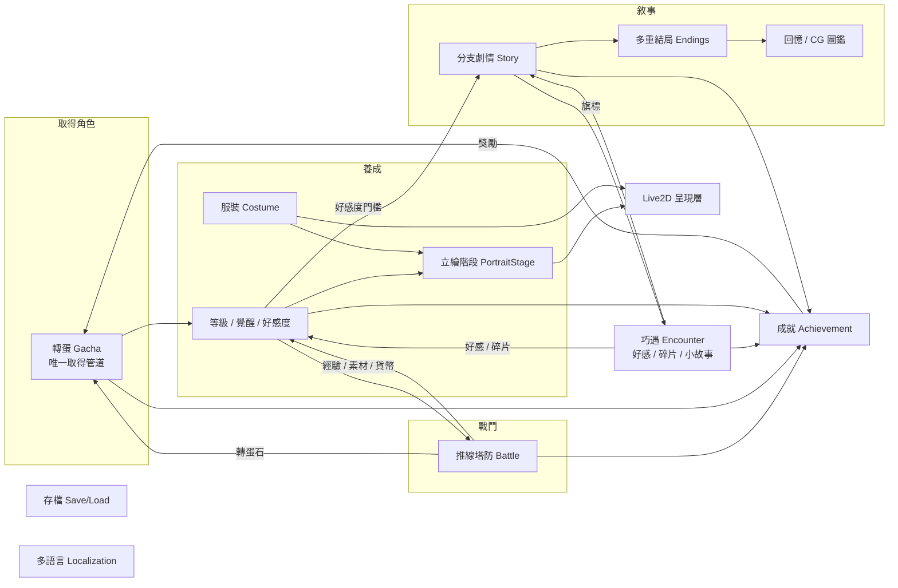

# 01 遊戲概觀與核心循環

> 狀態：草案 v0.1（2026-10-14）｜範圍：系統架構，不含美術生成

## 1. 一句話定位
「類貓咪大戰爭」的橫向推線塔防，加上角色收集、養成和戀愛 ADV 分支劇情：
**戰鬥取得資源 → 養成角色 → 解鎖立繪、劇情和服裝 → 角色變強後再去挑戰更難的關卡。**

## 2. 系統地圖

- **橫切系統**：存檔、多語言、Live2D 呈現、內容分級（見 [02](02_tech_stack_and_platform.md)）、成就。
- 每個子系統都是獨立模組，只透過**領域事件**（Domain Event）互相通知，不直接互相呼叫（見 [03](03_client_architecture.md)）。

## 3. 核心循環

| 循環 | 時間尺度 | 內容 | 主要系統 |
|---|---|---|---|
| 微循環 | 1–3 分鐘 | 一場推線戰鬥：出兵 → 推進 → 打爆敵方據點 | Battle |
| 中循環 | 10–20 分鐘 | 拿戰利品升級／覺醒角色 → 立繪改變 → 解鎖一段劇情或巧遇 | Growth、Story、Encounter |
| 長循環 | 數天到數週 | 收集角色、走完各角色路線、解鎖多重結局、補滿 CG 圖鑑和成就 | Gacha、Story、Achievement |

## 4. 角色的三條成長軸（關鍵設計）
角色的成長分成三條互不干擾的軸，避免「戰力」和「劇情尺度」綁在一起：

| 軸 | 提升方式 | 影響 |
|---|---|---|
| **等級 Lv** | 戰鬥經驗、經驗素材 | 戰鬥數值 |
| **覺醒 Awakening（★）** | 重複角色（轉蛋）、角色碎片（巧遇） | 戰鬥數值上限、技能、**立繪階段** |
| **好感度 Affection** | 巧遇事件、送禮、編隊出戰、劇情選項 | **劇情章節、結局分支、親密 CG（Tier）**、專屬服裝 |

> 「角色能透過升級改變立繪」在這裡實作成：**立繪階段由「等級＋覺醒」決定**（[06](06_character_growth_portrait.md)）。
> 親密內容（Tier 1–4）由**好感度和劇情進度**決定，而且每段內容都受建置版本的分級上限約束。

## 5. 設計原則
1. **資料驅動**：角色、關卡、卡池、劇情、成就全部寫成資料，不寫死在程式裡。企劃改表格就能調整，不必改程式碼。
2. **美術可缺席**：每個需要美術的地方都有預留圖（placeholder）和降級方案（例如沒有 Live2D 就顯示靜態立繪），這樣美術進度不會卡住程式開發。
3. **領域邏輯和 Unity 分離**：戰鬥模擬、轉蛋、養成計算都寫成純 C#，可以做單元測試，也能直接搬到伺服器驗證。
4. **分級在建置時決定**：成人內容不能只是「隱藏」，必須在打包時**完全不放進**本體，只放在成人 DLC（見 [02](02_tech_stack_and_platform.md) ADR-003）。
5. **先離線、預留連線**：第一版是單機。所有改變玩家狀態的操作都透過 `IGameService` 介面，之後可以換成伺服器實作。
