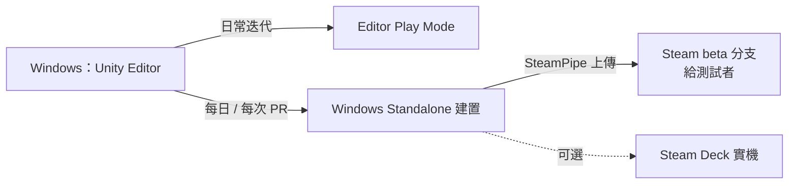

# 02 技術選型與平台策略（ADR）

> 狀態：建議案（2026-10-14）。**主平台已依使用者指示改為 Steam（Windows PC）**；iOS / Android 為可選的後續移植。

## ADR-001 遊戲引擎：Unity 6 LTS（建議）

| 候選 | Live2D 支援 | 推線戰鬥 | 分支劇情 | Steam 整合 | 結論 |
|---|---|---|---|---|---|
| **Unity 6 LTS** | **官方 Cubism SDK for Unity** | 適合 | Yarn Spinner / Ink 套件成熟 | Steamworks.NET（MIT） | **建議採用** |
| Godot 4 | 只有社群外掛，非官方 | 適合 | 要另外整合 | GodotSteam | 備案：Live2D 風險高 |
| Ren'Py | 有 Live2D 支援 | **不適合**即時戰鬥 | 很強 | 可以上 Steam | 不採用 |
| Web / Expo | — | — | — | — | 不採用（上一輪的 Expo 建議只適用一般手機 App） |

**理由**：Live2D 官方 SDK 以 Unity 版最成熟。同一套程式未來也能移植 iOS、Android、Steam Deck 和 macOS，保留後續擴展的空間。

### 主要套件
| 用途 | 套件 | 授權 / 備註 |
|---|---|---|
| Live2D | Live2D Cubism SDK for Unity（Cubism 5） | 需簽 Live2D 的 SDK 授權；**小規模事業可免費發行，門檻與條件以官方最新條款為準，上架前要確認** |
| Steam | Steamworks.NET | MIT；負責成就、Steam Cloud、DLC 判定、Rich Presence |
| 劇情腳本 | **Yarn Spinner**（建議） | MIT；內建以 line ID 為基礎的多語言流程（見 [08](08_story_branching.md)） |
| 資產載入 | Addressables | 依分級分 group，可做到建置時排除（ADR-003） |
| 多語言 | Unity Localization | String Table、Asset Table |
| 文字渲染 | TextMeshPro | CJK 用動態字型 atlas |
| 非同步 / DI | UniTask / VContainer | MIT |
| UI | uGUI ＋ DOTween（或 LitMotion） | |
| 測試 | Unity Test Framework（NUnit） | 領域層純 C# 單元測試 |

## ADR-002 開發與測試流程（Windows 本機就能完成）

- 改成 PC 主平台後，**開發和測試都能在 Windows 上完成，不需要 Mac**。這比原本的 iPhone 路線快很多。
- Steam 的 beta 分支（branch 加密碼）可以直接發給外部測試者，不需要 TestFlight。
- **解析度基準**：1920×1080（16:9）。UI 需要適應 16:10（Steam Deck 1280×800）和 21:9（兩側延伸背景）。
- **輸入**：滑鼠為主，鍵盤快捷鍵（1–0 出兵、空白鍵發動技能、Ctrl 快進劇情）。手把支援列為 Steam Deck 加分項，M3 再評估。

## ADR-003 內容分級：本體 ＋ 成人 DLC（建議）

### 平台事實（2026-10 時點；送審前要再次確認 Steamworks 最新規範）
- Steam 允許成人內容。開發者要在內容問卷中申報，有成人內容的遊戲會套用 Steam 的成人內容過濾，**而且部分地區看不到**。
- 業界常見做法是**本體不含 R18 內容、成人內容另外做成免費 DLC**。這樣本體能在商店正常曝光、觸及較多地區，想看成人內容的玩家再自行安裝 DLC。
- 最終採用「單一成人版本體」還是「本體＋DLC」，是商業決策，**要由使用者決定**。架構設計兩種都支援。

### 分級標記
| 分級 | 對應內容 | 本體 | 成人 DLC |
|---|---|---|---|
| `G` 全年齡 | 一般立繪、Tier 1 曖昧 | ✅ | |
| `R15` | 泳裝和輕度性感（**Tier 2 露點不算 R15**） | ✅ | |
| `R18` | Tier 2 露點、Tier 3、Tier 4 | ❌ | ✅ |

- 所有**資產、劇情節點、服裝、CG、成就**都帶 `rating` 欄位（見 [04](04_data_model.md)）。
- Addressables 依分級分成 `content_g` / `content_r15` / `content_r18` 三組 group。`content_r18` 打包成**獨立的 catalog 和 bundle**，作為 DLC 的 depot 內容。
- 遊戲啟動時，用 Steamworks `BIsDlcInstalled` 確認 DLC 已安裝，**而且** R18 catalog 檔案存在，才載入 R18 內容。之後還要通過年齡確認畫面（Age Gate）才會顯示。
- 劇情遇到 R18 節點、但目前不允許顯示時，走節點宣告的 `fallback`（例如「淡出到隔天早上」），所以劇情仍然連貫。
- CI 閘門：建置本體後掃描 catalog，發現任何 R18 key 就讓建置失敗。

## ADR-004 商業模式與轉蛋：遊戲內貨幣限定（建議）
- 建議採用**買斷制（buy-to-play）**，轉蛋**只用遊戲內獲得的貨幣**，不接受真錢購買。
  - 好處：不需要伺服器判定和防作弊；也避開各國對付費隨機抽獎的法規（例如比利時禁止付費 loot box、日本禁止「complete gacha」、台灣要求公告機率）。
  - 機率仍然會在遊戲內公開，做為良好實踐（見 [07](07_gacha_and_encounter.md)）。
- 第一版完全離線。所有狀態變更還是透過 `IGameService` 命令介面（見 [03](03_client_architecture.md))，日後如果改成付費轉蛋或移植手機版，可以換成伺服器實作。

## ADR-005 Steam 整合範圍
| 功能 | 做法 | 時程 |
|---|---|---|
| 成就 | `IPlatformAchievements`：遊戲內成就 ID 對應 Steam API name（見 [13](13_achievements.md)） | M2 |
| 存檔 | **只存在本機**（使用者指示 2026-10-14）：`%USERPROFILE%\AppData\LocalLow\<company>\<game>\saves\`；**不啟用 Steam Cloud**，也不上傳任何玩家資料或遙測（見 [11](11_save_load.md)） | M1 |
| DLC 判定 | 成人 DLC、後續服裝 DLC | M3 |
| 語言 | 預設使用 Steam 的遊戲語言設定，玩家可在遊戲內覆寫（見 [12](12_localization.md)） | M1 |
| Rich Presence | 顯示目前所在章節 | M4（選做） |

- 平台相關程式碼都包在 `IPlatformService` 後面，並另外實作 `NullPlatformService`，讓 Editor 和非 Steam 版本也能執行。

## 待使用者決定
1. 引擎是否採用 Unity（建議採用）。
2. 成人內容要做成**本體＋免費成人 DLC**（建議），還是**單一成人本體**。
3. 是否堅持買斷制、轉蛋不收真錢（建議堅持；如果要收真錢，伺服器和法遵的工作量會大幅增加）。
