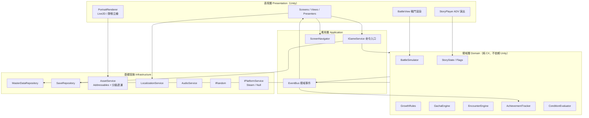

# 03 用戶端架構

## 1. 分層



### 依賴規則
- Domain **不可以**引用 `UnityEngine`。放在獨立的 asmdef（`Game.Domain`），並設定 `noEngineReferences: true`，讓編譯器強制這條規則。
- Presentation 不可以直接修改玩家狀態，一律透過 `IGameService` 送出命令。
- 子系統之間不互相引用。例如 Gacha 不知道 Achievement 的存在，只會發出 `GachaPulled` 事件。

## 2. 命令與事件（狀態變更的唯一路徑）

```csharp
public interface IGameService {
    UniTask<Result<GachaResult>> PullGacha(BannerId banner, int count);
    UniTask<Result> LevelUp(CharacterId id, IReadOnlyList<ItemStack> materials);
    UniTask<Result> Awaken(CharacterId id);
    UniTask<Result<BattleReward>> SubmitBattle(StageId stage, BattleReport report);
    UniTask<Result<EncounterOutcome>> ResolveEncounter(EncounterId id, int choiceIndex);
    UniTask<Result> EquipCostume(CharacterId id, CostumeId costume);
    UniTask<Result> SetLobby(SceneId scene, CharacterId ch, CostumeId costume);
    // ...
}
```

- `LocalGameService` 的處理流程：驗證 → 呼叫 Domain 規則 → 修改 `PlayerState` → 發出領域事件 → 存檔（debounce 合併寫入）。
- 換成 `RemoteGameService` 時，同樣的命令改送到伺服器，回應帶回新狀態差異和事件。
- **領域事件**（節錄）：`GachaPulled`、`CharacterObtained`、`CharacterLeveledUp`、`CharacterAwakened`、`PortraitStageUnlocked`、`AffectionChanged`、`BattleFinished`、`EncounterResolved`、`StoryNodeReached`、`EndingReached`、`CostumeUnlocked`、`AchievementUnlocked`。

## 3. 場景與畫面流程
- Unity Scene 只有三個：`Boot`（初始化服務、載入主資料、讀取存檔）、`Main`（所有選單 UI ＋ Lobby ＋ ADV）、`Battle`（戰鬥，additive 載入）。
- 選單用 `ScreenNavigator` 堆疊管理（push / pop / replace），不用切換 Scene，轉場比較快。
- ADV 劇情播放器 `StoryPlayer` 是覆蓋在 Main 之上的 overlay，可以從任何畫面呼叫（巧遇、角色劇情、主線）。

## 4. 資產載入（AssetService）
- 所有資產用**邏輯 key** 取得，不使用檔案路徑：`AssetService.Load<T>(AssetKey key)`。
- 每個 key 在 manifest 裡都有 `rating`。`AssetService` 依照 `BuildProfile.MaxRating` 和玩家設定做第二層過濾；第一層過濾在建置時已經完成（見 [02](02_tech_stack_and_platform.md) ADR-003）。
- key 找不到時回傳 **placeholder**（灰色剪影、角色名稱文字），並寫一筆警告 log，**不讓遊戲當掉**。這是讓美術進度不卡住開發的關鍵。
- 效能預算（PC 主平台初估，M0 實測後修正）：最低配備目標是內建顯示卡筆電加 8 GB RAM，**最低配備就由 M0 實測決定**。畫面上同時存在的 Live2D 模型 ≤ 3。CG 用完立刻釋放。立繪貼圖以 1080p 顯示為準（約 2048 px），4K 原圖只在圖鑑放大檢視時才載入。日後移植手機版時要另外訂一套預算。

## 5. 專案目錄（規劃）

```text
F:\game\
├── design\                 ← 本設計文件
├── data\                   ← 主資料原始檔（試算表匯出的 CSV / JSON），由企劃維護
│   ├── characters.csv  stages.csv  gacha_banners.json  achievements.csv ...
│   └── story\              ← .yarn 劇本
├── client\                 ← Unity 專案（M0 建立）
│   └── Assets\Game\
│       ├── Domain\         (asmdef: Game.Domain, noEngineReferences)
│       ├── Application\    (asmdef: Game.App)
│       ├── Infrastructure\ (asmdef: Game.Infra)
│       ├── Presentation\   (asmdef: Game.Presentation)
│       ├── Tests\          (EditMode：Domain 單元測試)
│       └── Content\        ← Addressables：content_g / content_r15 / content_r18
├── tools\                  ← 既有生圖工具；之後加入資料驗證和資產匯入腳本
└── assets\ sample\         ← 既有美術庫（原始素材，不直接進 Unity）
```

> 美術原始素材（`assets/`、`sample/`）與 Unity 的 `Content/` 分開放。由匯入腳本依 manifest 轉檔、縮圖後複製進 Unity（見 [15](15_asset_pipeline_contract.md)），避免 Unity 專案被大量 4K 原檔拖慢。

## 6. 主資料流程
`data/*.csv|json` → `tools/validate_data.py`（檢查 schema、交叉引用、分級一致性）→ Unity Editor 匯入器 → ScriptableObject 或執行期 JSON → `MasterDataRepository`（唯讀、啟動時載入）。
驗證失敗時禁止匯入，這是 CI 閘門。
