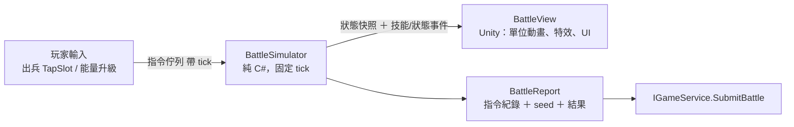

# 05 戰鬥系統（類貓咪大戰爭的推線塔防）

## 1. 規則摘要
- 橫向單線戰場：左邊是我方據點，右邊是敵方據點。
- **能量**（類似貓咪大戰爭的錢包）隨時間自動回復；玩家花能量從編隊（最多 10 格）出兵，每個角色有自己的冷卻時間。
- **能量等級**：花能量升級，提高能量上限和回復速度。
- **移除固有主堡砲，全面轉移為角色特殊技能機制（2026-11-04 重大演進）**：
  - 每個上場角色皆賦予專屬特殊技能與獨立技能充能條（Skill Charge Gauge）。
  - **單擊操作合一（One-Tap Interaction）**：
    - **技能未滿**：點擊角色卡牌即花費能量生成一個角色單位至戰場（Deploy）。
    - **技能條充能滿**：角色卡牌高亮呈現 `[💥大招就緒]`，點擊該角色卡牌立即釋放該角色的專屬特殊技能（CastSkill），釋放後充能條歸零重新蓄力。
  - **角色專屬技能類型**：
    - **巨砲轟炸（Cannon Effect）**：賦予特定角色（如 Scarlet 猩紅殲滅巨砲）類似原主堡砲的全場巨額破壞＋全體擊退清場。
    - **團隊治癒（Heal）**：如 Elysia 聖靈之祈，全體存活友軍百分比/定量回血＋解除負面異常狀態。
    - **團隊增益（Buff）**：如 Claire 女武神戰歌，全體友軍攻擊力提升 50%，持續 8 秒。
    - **異常效果（Debuffs / Status Effects）**：
      - **極寒緩速（Slow）**：如 Luna 極寒霜爆，全體敵軍移動速度與攻速大幅減緩 50%～60%。
      - **夜影劇毒（Poison DoT）**：如 Ayame 夜影劇毒，無視護甲每秒造成持續中毒傷害。
      - **紅蓮燃燒（Burn DoT）**：如 Sakura 紅蓮業火，瞬間爆發傷害附加持續灼燒。
      - **定身眩暈（Stun）**：如 Yuki 居合急凍，前排敵人短暫定身硬直。
- **主堡防衛特性（Base Traits：控場與傷害免疫）**：
  - **傷害類型免疫（Base Immunity）**：
    - `immune_ranged`：免疫遠端打擊（只有近戰攻城單位能造成傷害，例如 Golem 巨石據點）。
    - `immune_area`：免疫範圍型打擊（只有單體貫穿打擊能造成傷害）。
    - `immune_single`：免疫單體型打擊（只有範圍轟炸能造成傷害）。
  - **主堡控場反擊（Base CC）**：
    - `shockwave_on_hp_loss`：主堡每損失 20% 血量，爆發一次全屏衝擊波（Shockwave），將逼近主堡的攻城單位強制擊退並硬直 1 秒。
- 勝利條件：打爆敵方據點。失敗條件：我方據點被打爆，或時間到（部分關卡）。
- 單位會自動前進、遇敵後攻擊。每損失一定比例的 HP 會被擊退一次（`knockbacks` 決定次數）。

## 2. 架構：決定性模擬 ＋ 表現分離



- **固定 tick**：每秒 30 tick；數值運算使用定點數或 int（1/1000 單位），避免浮點誤差。
- **決定性**：相同的 `seed + 主資料版本 + 指令序列` 一定得到相同結果。支援回放、反作弊與無頭平衡模擬。
- `BattleView` 每一幀在兩個 tick 之間做插值，讓畫面順暢；**View 不修改任何模擬狀態**。
- 支援 1x / 2x 倍速和暫停：只改變每一幀推進的 tick 數。

## 3. 模擬核心
```text
每個 tick：
  1. 套用這個 tick 的玩家指令（Deploy / CastSkill / UpgradeEnergy）
  2. 能量回復、冷卻遞減、每個角色格子技能條充能推進、敵方 wave spawner 推進
  3. 移動：計算 Slow 減速修正後的 moveSpeed 前進
  4. 索敵：在射程內找最前方的敵人（single），或找範圍內所有敵人（area）
  5. 攻擊：計時器到了結算傷害（計算 AtkBuff 增益修正與特性相剋）
  6. 結算主堡傷害（檢查 immune_ranged 等免疫）與主堡反擊震波（shockwave_on_hp_loss）
  7. 擊退判定、死亡移除、發出事件（SkillCast, Heal, StatusApply, BaseImmune, BaseShockwave）
  8. 勝負判定
```

## 4. 主資料：Stage 與 Character
```jsonc
{
  "id": "st_1_02", "chapter": 1, "name": "loc:stage/st_1_02.name",
  "enemyBaseHp": 9000,
  "enemyBaseTraits": ["shockwave_on_hp_loss"], // 據點控場：每損血 20% 震退敵軍
  "waves": [ ... ]
}
```

```jsonc
{
  "id": "char03_scarlet",
  "battle": {
    "cost": 500, "cooldownSec": 10,
    "hp": 1500, "atk": 250,
    "skill": {
      "id": "skill_scarlet_cannon",
      "name": "猩紅殲滅巨砲",
      "chargeSec": 15.0,
      "effectType": "cannon",
      "value": 350,
      "range": 0 // 類似主堡砲之全場轟炸
    }
  }
}
```

## 5. 角色在戰鬥中的呈現
- 戰鬥場景**不使用**全身立繪，改用 **Q 版戰鬥單位**（sprite sheet 或簡易 Spine/Live2D 動畫：走路、攻擊、被擊退、死亡）。
- 角色出擊與釋放特殊技能時，畫面一角短暫切入該角色目前立繪階段的 bust 圖（cut-in），把「養成立繪」和戰鬥體驗連結起來。

## 6. 測試
- Domain 單元測試：傷害、擊退、能量回復、角色技能蓄力、TapSlot 操作、Heal/Buff/Slow/Poison/Burn、主堡免疫、主堡控場震波。
- **決定性回歸測試**：固定 BattleReport 黃金檔回放驗證。
- 平衡用的無頭模擬：在 Editor 批次跑「編隊 × 關卡」矩陣，輸出勝率和通關時間，做為數值調整的依據。
