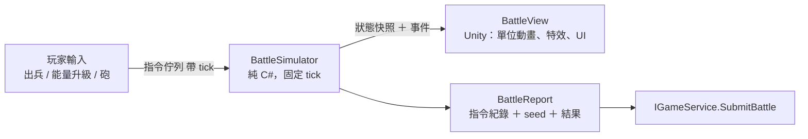

# 05 戰鬥系統（類貓咪大戰爭的推線塔防）

## 1. 規則摘要
- 橫向單線戰場：左邊是我方據點，右邊是敵方據點。
- **能量**（類似貓咪大戰爭的錢包）隨時間自動回復；玩家花能量從編隊（最多 10 格）出兵，每個角色有自己的冷卻時間。
- **能量等級**：花能量升級，提高能量上限和回復速度。
- **據點砲**（類似貓咪砲）：充能滿了以後發動，擊退整條線上的敵人並造成傷害。
- 勝利條件：打爆敵方據點。失敗條件：我方據點被打爆，或時間到（部分關卡）。
- 單位會自動前進、遇敵後攻擊。每損失一定比例的 HP 會被擊退一次（`knockbacks` 決定次數）。

## 2. 架構：決定性模擬 ＋ 表現分離



- **固定 tick**：每秒 30 tick；數值運算使用定點數或 int（1/1000 單位），避免浮點誤差。
- **決定性**：相同的 `seed + 主資料版本 + 指令序列` 一定得到相同結果。這帶來三個好處：可以做回放、可以重現 bug，日後也可以由伺服器驗證。
- `BattleView` 每一幀在兩個 tick 之間做插值，讓畫面順暢；**View 不修改任何模擬狀態**。
- 支援 1x / 2x 倍速和暫停：只改變每一幀推進的 tick 數。

## 3. 模擬核心
```text
每個 tick：
  1. 套用這個 tick 的玩家指令
  2. 能量回復、冷卻遞減、敵方 wave spawner 推進
  3. 移動：沒有接敵的單位依 moveSpeed 前進
  4. 索敵：在射程內找最前方的敵人（single），或找範圍內所有敵人（area）
  5. 攻擊：計時器到了就結算傷害（傷害公式見下）
  6. 擊退判定、死亡移除、發出事件
  7. 勝負判定
```
- **傷害** = `atk × 屬性相剋係數 × 特性修正`；特性例如 `anti_flying`，對特定敵人類型 ×1.5。
- 單位全部放在單一 x 軸上，用依 x 排序的陣列做空間查詢；一場同時存在約 200 個單位以內，O(n log n) 已經足夠。

## 4. 主資料：Stage
```jsonc
{
  "id": "st_1_01", "chapter": 1, "name": "loc:stage/st_1_01.name",
  "bg": "battle/bg/city_day", "bgm": "bgm/battle_01",
  "enemyBaseHp": 30000, "timeLimitSec": 0,
  "energy": { "start": 0, "maxByLevel": [1500, 2500, 3500, 4500, 5500, 6500, 7500, 8500], "regenByLevel": [...] },
  "waves": [
    { "enemy": "en_slime", "atSec": 3, "count": 5, "intervalSec": 4, "repeatEverySec": 30 },
    { "enemy": "en_boss_golem", "trigger": { "type": "enemy_base_hp_below_pct", "value": 50 }, "count": 1 }
  ],
  "rewards": { "firstClear": [{ "item": "gem", "n": 50 }], "drop": [{ "item": "exp_s", "n": 3, "rate": 0.6 }] },
  "starConditions": ["clear", "no_base_damage_pct_30", "within_sec_120"],
  "unlocksOnClear": ["st_1_02", "enc_spot_park"]
}
```
- 敵人（`en_*`）的欄位結構和角色的 `battle` 區塊相同，另外加上 `type`（例如 flying、armored）。

## 5. 角色在戰鬥中的呈現
- 戰鬥場景**不使用**全身立繪，改用 **Q 版戰鬥單位**（sprite sheet 或簡易 Spine/Live2D 動畫：走路、攻擊、被擊退、死亡）。
  ⚠ 這是現有美術庫**沒有**的資產類型，需要另外規劃（見 [15](15_asset_pipeline_contract.md)）。M1 先用色塊加頭像當 placeholder。
- 角色出擊時，畫面一角短暫切入該角色目前立繪階段的 bust 圖（cut-in），把「養成立繪」和戰鬥體驗連結起來。

## 6. 測試
- Domain 單元測試：傷害、擊退、能量回復、wave 觸發。
- **決定性回歸測試**：準備固定的 BattleReport 黃金檔，重新模擬後結果必須與紀錄完全一致。主資料改版造成結果改變時，要有意識地更新黃金檔。
- 平衡用的無頭模擬：在 Editor 批次跑「編隊 × 關卡」矩陣，輸出勝率和通關時間，做為數值調整的依據。
