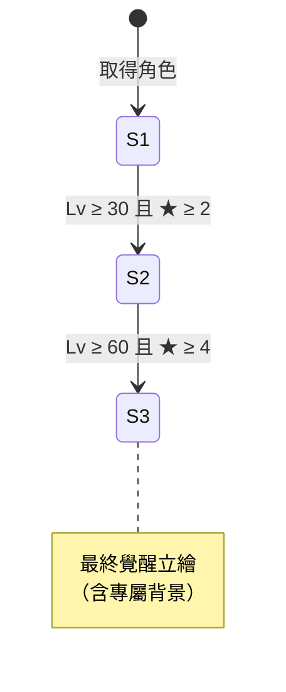

# 06 角色養成與立繪階段

## 1. 三條成長軸
| 軸 | 範圍 | 提升方式 | 影響 |
|---|---|---|---|
| 等級 Lv | 1 – 上限（上限由覺醒決定） | 戰鬥經驗、經驗素材 `exp_s/m/l` ＋ 金幣 | 戰鬥數值（依 growthCurve） |
| 覺醒 ★ | 0 – 5 | 重複角色（轉蛋）或角色碎片（巧遇、商店兌換） | 等級上限 +10／★、解鎖技能、**解鎖立繪階段** |
| 好感度 | 0 – 1000（分 5 級） | 巧遇事件、送禮、編隊出戰勝利、劇情選項 | 劇情章節、親密 CG、結局分支、專屬服裝 |

建議的等級上限：★0 = 20，★1 = 30 … ★5 = 70（數值只是初估，之後依平衡調整）。

## 2. 立繪階段（PortraitStage）：升級後立繪改變


- 每個角色預設有 3 個階段，數量可以透過資料調整；解鎖條件使用通用條件 DSL（見 [04](04_data_model.md)），所以可以改成任何組合。
- 解鎖時播放**覺醒演出**：舊立繪先發光並碎裂，新立繪登場，接著播放角色語音和一句台詞。演出結束後發出 `PortraitStageUnlocked` 事件。
- **玩家可以自由切換已解鎖的階段**（很多玩家偏好初始造型）。目前選用的階段記錄在 `characters.<id>.portraitStage`。
- **立繪階段和服裝的關係**：最後顯示的立繪 = `服裝 ?? 立繪階段預設造型`。服裝屬於「造型覆寫」，詳見 [10](10_costume_and_scene.md)。
- **分級**：PortraitStage 本身應維持 `G` / `R15`。親密程度的 Tier 內容放在劇情 CG（見 [08](08_story_branching.md)），不放在立繪階段，讓戰力和尺度保持脫鉤。

## 3. 好感度等級和解鎖內容
| 好感等級 | 門檻 | 解鎖範例 |
|---|---|---|
| 1 初識 | 0 | 角色檔案、第 1 章劇情 |
| 2 熟悉 | 100 | 第 2 章、Lobby 互動台詞增加 |
| 3 曖昧 | 300 | 第 3 章（Tier 1 CG）、專屬服裝 A |
| 4 親密 | 600 | 第 4 章（Tier 2；本體版走 fallback） |
| 5 戀人 | 1000 | 最終章、結局分支（Tier 3/4 只在成人 DLC 中出現） |

- 好感度只是**解鎖章節的門檻**。結局走向由劇情中的選擇旗標決定（見 [08](08_story_branching.md)），不是單純比好感度高低。

## 4. 數值公式（初版）
```text
stat(Lv) = base × curve[Lv] × (1 + 覺醒加成[★]) × (1 + 立繪階段 statBonus) × (1 + 被動加成)
升級所需經驗 = expTable[rarity][Lv]
```
- `curve` 和 `expTable` 都放在主資料，不寫死在程式中。
- 公式全部在 `GrowthRules`（Domain 層）實作，搭配表格驅動的單元測試。

## 5. 角色詳情畫面需要的資料
等級／經驗條、覺醒星等、好感度、戰鬥數值、目前立繪（Live2D 或靜態圖）、立繪階段切換列（未解鎖的顯示剪影和解鎖條件）、服裝列表、劇情章節列表、語音試聽、角色檔案（多語言）。
