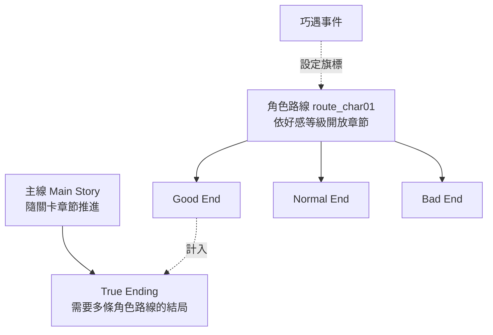

# 08 互動劇情與多重結局

## 1. 劇情結構

- **主線**：和關卡章節綁定，所有玩家共用。
- **角色路線**：每位角色 5 章，依好感等級開放（見 [06](06_character_growth_portrait.md)）。最終章依路線內累積的旗標分出 Good / Normal / Bad 結局。
- **True Ending**：需要達成指定數量角色的 Good End，再加上主線通關。
- 結局一旦達成，就永久記錄在 Profile 的 `endings`，並解鎖圖鑑和成就。

## 2. 腳本格式：Yarn Spinner
選擇 Yarn Spinner 的理由：
1. 每一行台詞都有穩定的 `#line:` ID，可以直接對應多語言的 String Table（見 [12](12_localization.md)）。
2. 寫作者能看懂的純文字格式；分支、變數、條件都是內建語法。
3. 可以自訂演出指令（`<<command>>`）。

### 範例
```yarn
title: Route_Claire_Ch3
tags: rating:G
---
<<bg scene_academy_rooftop sunset>>
<<show char01_claire pose=stand expr=tsundere at=center>>
Claire: 才、才不是特地在等你呢！ #line:rc3_001
-> 「我也想見妳。」 #line:rc3_002
    <<set $claire_trust to $claire_trust + 1>>
    <<expr char01_claire shy>>
    Claire: ……笨蛋。 #line:rc3_003
-> 「那我先走了。」 #line:rc3_004
    <<set $claire_trust to $claire_trust - 1>>
<<if $claire_trust >= 3>>
    <<jump Route_Claire_Ch3_Intimate>>
<<else>>
    <<jump Route_Claire_Ch3_End>>
<<endif>>
===
title: Route_Claire_Ch3_Intimate
tags: rating:R18 fallback:Route_Claire_Ch3_FadeOut
---
<<cg cg_char01_t2_01>>
...
===
```

### 自訂指令（StoryCommandRegistry）
| 指令 | 作用 |
|---|---|
| `<<bg scene_id [variant]>>` | 切換背景（使用場景資料，見 [10](10_costume_and_scene.md)） |
| `<<show char pose= expr= at= costume=>>` / `<<hide char>>` | 角色登場或退場；沒指定 costume 就用玩家目前選用的服裝 |
| `<<expr char name>>` / `<<motion char name>>` | 切換 Live2D 表情或動作（靜態立繪則換成差分圖） |
| `<<cg cg_id>>` | 全螢幕 CG，同時解鎖圖鑑 |
| `<<bgm id>>` / `<<se id>>` / `<<voice id>>` | 音訊 |
| `<<affection char n>>` / `<<give item n>>` | 透過 `IGameService` 結算獎勵 |
| `<<ending route.ending_id>>` | 記錄結局，並播放結局演出 |
| `<<wait sec>>` / `<<shake>>` / `<<fade>>` | 演出效果 |

## 3. 分級與 fallback
- 節點的 `rating:` tag 預設為 G。`StoryPlayer` 進入節點前先檢查 `rating_allowed`；不允許就跳到 `fallback:` 指定的節點。**fallback 必須存在**，這條規則由資料驗證器檢查。
- `<<cg>>` 引用的 CG 也有自己的分級。CG 不允許顯示時，跳過 CG、只顯示文字（或替代用的 G 版 CG）。
- 本體版只有 R18 的 key，沒有實體檔案（見 [02](02_tech_stack_and_platform.md) ADR-003），所以就算 fallback 寫錯，也只會顯示 placeholder，不會外洩內容。

## 4. 變數範圍
| 範圍 | 存在哪裡 | 例子 |
|---|---|---|
| 劇情變數 `$route_*`、`$claire_trust` | **劇情存檔欄位**（每個欄位各自一份） | 路線內的選擇累積 |
| 全域旗標 | Profile（所有存檔欄位共用） | 已讀行、已見結局、圖鑑 |
| 遊戲狀態（唯讀） | 透過 Yarn 函式查詢 `affection("char01_claire")`、`owned("char07_kagura")` | 用來判斷條件 |

這樣玩家讀取舊存檔、改走另一個分支時，**持有的角色、等級和轉蛋紀錄都不會倒退**，只有劇情變數會回到存檔當下（見 [11](11_save_load.md)）。

## 5. ADV 播放器功能清單
文字速度、自動播放、**快進**（只快進已讀行，可在設定改成快進全部）、回想紀錄（Backlog，可以重聽語音）、隱藏 UI、快速存讀檔、**分支圖**（顯示路線節點樹：已走過的節點標亮，未走過的顯示 ???），方便玩家追求多重結局。

## 6. 回憶與圖鑑
- **回憶**：已讀過的章節可以重新播放。重播時使用暫時的劇情變數，**不影響**任何存檔。
- **CG 圖鑑**：依角色分頁，可以全螢幕放大檢視。R18 的 CG 只在成人 DLC 安裝而且通過年齡確認後才列出。
- **結局列表**：顯示達成率，未達成的結局顯示提示文字。

## 7. 驗證工具
`tools/validate_story.py`（或 Yarn 編譯期檢查）：
- 所有 `<<jump>>` 目標都存在、所有 `fallback` 都存在。
- 每一行都有 `#line:` ID，而且沒有重複。
- 引用的角色、CG、場景 ID 都存在於主資料中。
- **可達性分析**：每個結局至少有一條可以走到的路徑；列出無法到達的節點。
