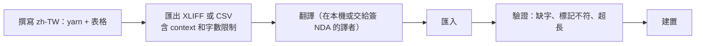

# 12 多語言

## 1. 語言範圍（建議）
| 優先順序 | 語言 | 代碼 | 備註 |
|---|---|---|---|
| 原文 | 繁體中文 | `zh-TW` | 劇本撰寫語言 |
| 第一波 | 英文、日文、簡體中文 | `en` `ja` `zh-CN` | Steam 二次元／成人遊戲的主要客群 |
| 第二波 | 韓文 | `ko` | |

## 2. 架構
| 類型 | 做法 |
|---|---|
| UI 文字 | Unity Localization 的 String Table：`UI`、`Char`、`Item`、`Stage`、`Gacha`、`Ach`、`Scene` |
| 劇情台詞 | Yarn Spinner 的 line ID（`#line:xxx`）→ 每種語言一份 CSV 字串表（Yarn 內建匯出和匯入） |
| 資料中的文字 | 主資料只存 `loc:<table>/<key>`，**不存原文**（見 [04](04_data_model.md)） |
| 帶文字的圖片 | Asset Table（例如標題 Logo、卡池橫幅），依語言切換 |
| 語音 | 只做日文配音（建議）；字幕跟著介面語言。語音語言和介面語言是兩個獨立設定 |
| 格式化 | 數字、日期使用 locale 格式；複數和性別使用 Smart String |

## 3. 翻譯流程

- 每一行文字都附帶 **context**：說話者、場景、UI 欄位的最大寬度。
- ⚠ 專案禁止外洩：**不使用任何線上機器翻譯或雲端 TMS**。翻譯檔只在本機處理，外包譯者需要先簽 NDA，交付方式另議。
- 驗證器檢查項目：缺少翻譯、`{0}` 這類佔位符數量不一致、富文字標籤不成對、超過 UI 寬度（依每種語言的字型量測）。

## 4. 字型
- TextMeshPro 動態 atlas：每種 CJK 語言各一套字型（繁中、簡中、日文的字形不同，**不能共用同一套中文字型**）。
- Fallback 鏈：目前語言的字型 → 共用的拉丁字型 → 符號字型。
- 字型授權必須允許**嵌入遊戲並商業發行**，建議使用 SIL OFL 授權的字型，例如 Noto Sans CJK 或源樣黑體。

## 5. 切換
- 第一次啟動時，跟隨 Steam 的遊戲語言設定（`GetCurrentGameLanguage`）；沒有對應的語言就使用 `en`。
- 設定頁可以**即時切換**，所有 UI 透過 `LocalizedString` 綁定，切換時自動刷新。正在播放的劇情會從下一行開始套用新語言。
- UI 版面要預留文字長度：英文約為中文的 1.5–2 倍、德文更長（如果日後加入）。按鈕用 auto-size，並設定最小字級。
