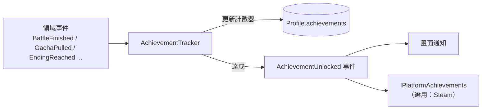

# 13 成就系統

## 1. 資料驅動、事件觸發

- `AchievementTracker` 只訂閱事件，**其他系統完全不知道成就的存在**。新增成就只需要改資料，不需要改程式碼。

## 2. 主資料
```jsonc
{
  "id": "ach_gacha_100", "category": "collection",     // battle / growth / collection / story / encounter / hidden
  "name": "loc:ach/ach_gacha_100.name", "desc": "loc:ach/ach_gacha_100.desc",
  "icon": "ui/ach/gacha", "rating": "G", "hidden": false,
  "trigger": { "event": "GachaPulled", "counter": "sum", "field": "count", "target": 100 },
  "reward": [{ "item": "gem", "n": 300 }],
  "steamApiName": "ACH_GACHA_100"
}
```

| counter 類型 | 說明 | 例子 |
|---|---|---|
| `sum` | 累加事件中某個欄位的值 | 抽 100 次、累計擊敗 10,000 個敵人 |
| `count` | 累計符合 filter 的事件次數 | 用 3★ 通關 50 個關卡 |
| `distinct` | 累計不重複的值 | 收集 30 位不同角色 |
| `state` | 每次事件後用通用條件 DSL 重新判斷 | 任一角色達到 ★5、達成全部 Good End |

- `filter`：用來篩選事件，例如 `{"rarity": "SSR"}`、`{"stage": "st_3_*"}`。
- **追溯計算**：成就新增或修改後，載入存檔時對 `state` 和 `distinct` 類型重新計算一次，確保老玩家也能取得新成就。

## 3. 成就分類建議（初版約 80 個）
| 分類 | 數量 | 例子 |
|---|---|---|
| 戰鬥 | 20 | 首勝、無傷通關、只用 3 名角色通關 |
| 養成 | 15 | 首次覺醒、任一角色解鎖 S3 立繪 |
| 收集 | 15 | 持有 10／25／50 位角色、取得 30 套服裝 |
| 劇情 | 20 | 每位主要角色的 Good End、True End、看過全部 Bad End |
| 巧遇 | 5 | 完成 10 個巧遇系列 |
| 隱藏 | 5 | 特殊互動彩蛋 |

- R18 成就（例如達成 Tier 4 CG）的 `rating` 設為 R18，只在成人 DLC 啟用時出現。**Steam 成就清單是公開的**，所以 R18 成就**不設定 `steamApiName`**，只留在遊戲內。

## 4. 平台同步（待使用者決定）
- 遊戲內的成就和進度**一律存在本機 Profile**。
- 解鎖 Steam 成就時會把「哪個成就已達成」送到 Steam 伺服器。這是 Steam 遊戲的標準功能，但會產生對外通訊。
  依照「資料保留在本機」的原則，**預設只寫入本機**；要不要同步到 Steam 成就，由使用者決定。介面已經用 `IPlatformAchievements` 隔離，開或關只需要一行設定。

## 5. UI
- 成就頁：分類分頁、進度條（例如 37/100）、獎勵領取按鈕、隱藏成就顯示「???」。
- 達成時在右上角顯示 toast；劇情播放中先暫存，劇情結束後才顯示，避免打斷沉浸感。
