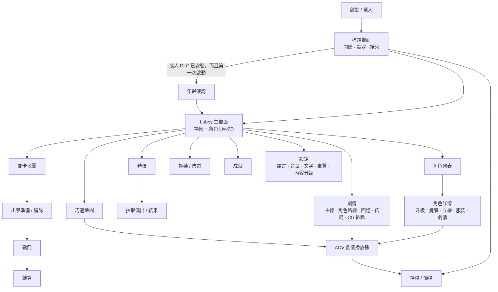

# 14 介面畫面規劃

## 1. 畫面流程


## 2. Lobby 主畫面（16:9，1920×1080）
```text
┌────────────────────────────────────────────────────────────────────┐
│ [頭像 Lv]  ◆金幣 12,300  💎寶石 4,500  ⚡巧遇 3/5        [⚙] [≡]  │
│                                                                    │
│                                         ┌──────────────┐           │
│   （玩家選定的場景背景，有視差）         │  劇情         │           │
│                                         │  巧遇         │           │
│          （角色 Live2D 全身／膝上）       │  轉蛋   NEW  │           │
│           點擊會有反應，視線跟隨滑鼠      │  角色         │           │
│                                         │  換裝         │           │
│     ┌───────────────────────┐           │  成就   ●     │           │
│     │ 對話泡泡：「今天也要…」 │           └──────────────┘           │
│     └───────────────────────┘                  ┌──────────────────┐ │
│                                                │   ▶ 出擊（關卡）  │ │
│                                                └──────────────────┘ │
└────────────────────────────────────────────────────────────────────┘
```

## 3. 出擊和戰鬥
```text
戰鬥畫面：
┌────────────────────────────────────────────────────────────────────┐
│ [‖] [x2]     敵方據點 HP ████████░░ 72%                    02:14   │
│ [我方據點]  ←———————  戰場（單線橫向捲動）  ———————→  [敵方據點]   │
│                                                                    │
│ ⚡ 1,240 / 3,500   [能量 Lv3 ↑ 800]                    [據點砲 ███] │
│ [1][2][3][4][5][6][7][8][9][0]   ← 角色卡：頭像、費用、冷卻遮罩     │
└────────────────────────────────────────────────────────────────────┘
```
- 戰場可以用滑鼠拖曳或滾輪橫向捲動。
- 卡片狀態：能量不足（灰色）、冷卻中（順時針遮罩）、可出擊（發亮）。

## 4. 角色詳情
```text
┌──────────────────────────┬─────────────────────────────────────────┐
│                          │ Claire  ★★☆☆☆  SSR  遠程               │
│   （Live2D 立繪展示，     │ Lv 32/40  ████████░░  EXP               │
│     可以拖曳改變視角）    │ HP 4,210  ATK 620  射程 320  費用 450   │
│                          │ [升級] [覺醒（碎片 8/10）]               │
│  立繪階段：[S1][S2●][S3🔒]│ 好感：Lv3 曖昧 ███░░  340/600            │
│                          │ ─ 分頁：[檔案][服裝][劇情][語音]          │
└──────────────────────────┴─────────────────────────────────────────┘
```

## 5. ADV 播放器
- 底部對話框：名字、文字、`▼` 繼續提示；角落按鈕：自動、快進、Backlog、存檔、讀檔、設定、隱藏 UI、分支圖。
- 選項：畫面中央 2–4 個按鈕。已選過的選項打勾，方便玩家找出還沒走過的分支。

## 6. UI 技術規範
- 每個 Screen 包含一個 Prefab、一個 View（只負責顯示）和一個 Presenter（訂閱狀態、呼叫 `IGameService`）。Presenter 可以用假的 GameService 做單元測試。
- 共用元件：貨幣列、角色卡、稀有度框、確認對話框（**不使用作業系統原生對話框**）、Toast、Loading 遮罩、紅點通知系統（依資料驅動）。
- 所有顯示文字都使用 `LocalizedString`；所有圖片都使用 `AssetKey`。**Prefab 裡不寫死任何文字或路徑**。
- 設計解析度 1920×1080，Canvas Scaler 設為 Match 0.5，並另外測試 16:10 和 21:9。
- 鍵盤：Esc 返回上一層；ADV 中 Space 或 Enter 前進、Ctrl 快進、H 隱藏 UI。
