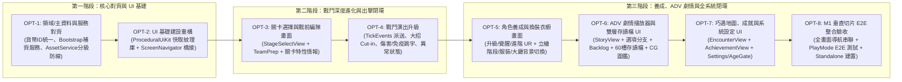

# 19 架構優化與 M1 垂直切片實作藍圖（Gemini 3.8 執行計畫）

> **文件性質**：架構師總體規劃與分步實作規格書（Architecture & Execution Blueprint）
> **建立日期**：2026-11-04
> **交接對象**：`Gemini 3.8 Flash (High)`（實作者）＆ 監督者（驗收者）
> **依據文件**：[`design/03_client_architecture.md`](03_client_architecture.md)、[`design/14_ui_screens.md`](14_ui_screens.md)、[`design/16_roadmap.md`](16_roadmap.md)、[`design/17_framework_worklist.md`](17_framework_worklist.md)、[`client/GEMINI_PROTOCOL.md`](../client/GEMINI_PROTOCOL.md)

---

## 1. 架構現況診斷與技術債盤點（Architectural Audit）

經過對 `Game.Domain`、`Game.Core`、`Game.Unity` 與 `Game.Tests` 全數原始碼與主資料的深度審查，目前專案已完成 **M0 技術底座（353 項 .NET 測試 + 372 項 Unity EditMode 測試通過）**，但在邁向 **M1 垂直切片（Vertical Slice）** 與長期維護上，存在 **7 大核心架構斷層與技術債**：

| 編號 | 診斷維度 | 現況與問題根因（附原始碼出處） | 架構風險與影響 |
| :--- | :--- | :--- | :--- |
| **ARCH-01** | **UI 程序化紋理重工與記憶體洩漏** | [`LobbyView.cs`](../client/Assets/Game/Unity/UI/LobbyView.cs#L1079-L1256) 與 [`GachaView.cs`](../client/Assets/Game/Unity/UI/GachaView.cs) 各自複製貼上了一整套 `CreatePillSprite`、`CreateGradientSprite`、`CreateCircleSprite` 等 CPU 逐像素生成函式，且未快取或釋放 `Texture2D`，導致 `GachaView.cs` 膨脹至 84 KB（1,765 行）、`LobbyView.cs` 達 59 KB（1,340 行）。 | 每次建立 UI 都阻塞主執行緒進行雙層迴圈 `SetPixel`，耗用大量非受控記憶體（Unmanaged Texture Memory），且未來新增 6 個畫面時將產生嚴重程式碼複製污染。 |
| **ARCH-02** | **導航系統繞過 `ScreenNavigator` 與 `IScreen`** | `Game.Core.UI` 雖已實作完整的 [`ScreenNavigator.cs`](../client/Assets/Game/Core/UI/ScreenNavigator.cs#L33-L162) 與 [`IScreen.cs`](../client/Assets/Game/Core/UI/IScreen.cs)，但 Unity 表現層的 [`LobbyView.OpenGacha()`](../client/Assets/Game/Unity/UI/LobbyView.cs#L364-L374) 與 [`BattlePageView.EnterBattle()`](../client/Assets/Game/Unity/Battle/BattlePageView.cs#L58-L69) 卻直接呼叫 `GameObject.Find("LobbyUI")` 與 `SetActive(false)`。 | 畫面堆疊生命週期（`OnPush`/`OnPause`/`OnResume`/`OnPop`）、轉場鎖（`BeginTransition`）與統一 `Esc` 返回鍵攔截完全失效，多層畫面（如：大廳 → 角色列表 → 角色詳情 → ADV 回憶）必然發生狀態錯亂。 |
| **ARCH-03** | **主資料貨幣 ID 與 Presenter 雙軌分裂** | [`config.json`](../data/master/config.json#L19-L47) 與 [`banners.json`](../data/master/banners.json#L9) 定義貨幣 ID 為 `"gold"` 與 `"gem"`，但 [`CurrencyBarPresenter.cs`](../client/Assets/Game/Core/UI/CommonComponents.cs#L214-L216) 卻寫死查詢 `"item_gold"`、`"item_dia_free"`、`"item_dia_paid"`（曾引發 `BUG-009`）。此外 [`LobbyPresenter.cs`](../client/Assets/Game/Core/UI/Presenters.cs#L58) 預設角色 fallback 寫為 `"char_claire"`（正確 ID 為 `"char01_claire"`）。 | 導致 `CurrencyBarPresenter` 在正式環境讀出永遠為 0，且預設看板娘解析失敗退回 placeholder。 |
| **ARCH-04** | **大廳 5 大核心子系統入口仍為空殼 Toast** | [`LobbyView.cs`](../client/Assets/Game/Unity/UI/LobbyView.cs#L349-L408) 的「主線劇情」、「巧遇約會」、「部隊編組（含養成/突破/進階）」、「換裝衣櫥」、「戰役榮譽（成就）」與「系統設定」點擊後僅彈出 `ShowToast` 文字，雖後端 `GameCore` 與 `Presenters.cs` 已 100% 完成，卻無對應 UGUI View 可供操作。 | 玩家無法在遊戲內完成 M1 垂直切片要求的「角色升級/覺醒換立繪 → 編隊 → 選關出擊 → 巧遇/看劇情分歧 → 存讀檔拿雙結局」閉環。 |
| **ARCH-05** | **出擊按鈕硬編碼綁死第一關 `st_1_01`** | [`LobbyView.OnClickBattle()`](../client/Assets/Game/Unity/UI/LobbyView.cs#L391-L403) 直接呼叫 `runner.StartBattle("st_1_01")`，缺乏「關卡選擇地圖（Stage Select）」與「戰前編隊確認（Team Prep）」。 | 玩家打完 `st_1_01` 解鎖 `st_1_02`、`st_1_03` 後，在正式 UI 根本無法進入第二、三關，也無法針對第 2 關（震波主堡）、第 3 關（免疫遠程主堡）調整近戰/遠程編隊。 |
| **ARCH-06** | **戰鬥表現層缺乏技能與主堡特性的視覺回饋** | [`BattleSimulator.cs`](../client/Assets/Game/Domain/Battle/BattleSimulator.cs#L492-L583) 已在 `TickEvents` 發出 `SkillCast`、`Heal`、`StatusApply`、`BaseImmune`、`BaseShockwave`、`Hit`、`Knockback` 等事件，但 [`BattleRunner.cs`](../client/Assets/Game/Unity/Battle/BattleRunner.cs#L94) 標註 `TODO` 並直接丟棄 `TickEvents`，[`BattlePageView.cs`](../client/Assets/Game/Unity/Battle/BattlePageView.cs) 也未顯示角色大招 Cut-in、傷害跳字、異常狀態標籤或「免疫遠程 (`IMMUNE`)」提示。 | 玩家在第 3 關用遠程角色打主堡 0 傷害時不知原因（違反 `design/05 §5` Cut-in 與回饋設計），釋放大招也沒有視覺高潮感。 |
| **ARCH-07** | **資產載入繞過 `AssetCatalog` 分級防線與多語系未接線** | [`AssetService.cs`](../client/Assets/Game/Unity/AssetService.cs#L41) 仍留有 `TODO(manifest)`，而 `LobbyView` / `GachaView` 直接用 `File.ReadAllBytes(StreamingAssets/...)` 載入圖片，完全繞過 `AssetCatalog.Resolve(key, policy)` 的分級攔截；UI 文字亦全部硬編碼中文，未透過 `ILocalizationService` 與 `GameBootstrap` 串聯。 | 違反 `design/03 §4` 與 `design/14 §6`「第二層執行期分級過濾」及「UI 全面經由服務定位與多語系鍵值驅動」的核心安全契約。 |

---

## 2. 總體演進策略與架構設計原則

為了讓 `Gemini 3.8` 能以**高成功率、零回歸、嚴格邊界控制**的方式逐步完成改進，本計畫遵循 [`client/GEMINI_PROTOCOL.md`](../client/GEMINI_PROTOCOL.md) 的協作規範：

1. **單一職責與小步快跑（Small, Verifiable Steps）**：將整個優化與 M1 垂直切片拆解為 **8 個獨立工單（`OPT-1` ～ `OPT-8`）**，放在 `client/tasks/OPT-1.md` ～ `OPT-8.md`。
2. **嚴格遵守編譯與依賴紅線**：
   - **C# 9 語法限制**：禁止 `record`、`init`、`file-scoped namespace`、`global using`。
   - **分層隔離**：`Game.Domain`（純 C#）與 `Game.Core`（純 C# + Newtonsoft.Json）嚴禁引用 `UnityEngine`。
   - **雙引擎 100% 對齊**：每完成一步，`dotnet test client/DotnetTests` 與 Unity EditMode Test Runner 必須 0 錯誤、測試數量只增不減，且每步必須包含**陽性對照（Positive Control）**。
3. **抽取共用 UI 基礎建設（`ProceduralUiKit` ＆ `UnityScreenBase`）**：
   - 先在 `OPT-2` 建立帶全域紋理快取（Cache）的 `ProceduralUiKit.cs` 與對接 `ScreenNavigator` 的 `UnityScreenBase.cs`，後續 `OPT-3` ～ `OPT-8` 的新畫面只需 250～400 行即可寫出高顏值「二次元戰術終端風格」介面，徹底告別動輒 1,500 行的巨型 View。



---

## 3. 分步實作詳細規劃（Step-by-Step Implementation Plan for Gemini 3.8）

以下每個 Step 皆按 `GEMINI_PROTOCOL.md` 格式定義，可直接轉為 `client/tasks/OPT-X.md` 交由 `Gemini 3.8` 執行：

---

### Step 1 (`OPT-1`)：核心契約修復、服務註冊補齊與資產分級防線整合
- **解決痛點**：`ARCH-03`（貨幣與角色 ID 不一致）、`ARCH-07`（`GameServices` 缺 `Localization`/`Settings`/`AgeGate`/`AssetCatalog` 注入，`AssetService` 未執行 manifest 分級第二層過濾）。
- **允許新增或修改的檔案**：
  - 修改 [`client/Assets/Game/Core/UI/CommonComponents.cs`](../client/Assets/Game/Core/UI/CommonComponents.cs)
  - 修改 [`client/Assets/Game/Core/UI/Presenters.cs`](../client/Assets/Game/Core/UI/Presenters.cs)
  - 修改 [`client/Assets/Game/Unity/GameServices.cs`](../client/Assets/Game/Unity/GameServices.cs)
  - 修改 [`client/Assets/Game/Unity/GameBootstrap.cs`](../client/Assets/Game/Unity/GameBootstrap.cs)
  - 修改 [`client/Assets/Game/Unity/AssetService.cs`](../client/Assets/Game/Unity/AssetService.cs)
  - 修改 [`client/Assets/Game/Tests/PresenterAndServiceTests.cs`](../client/Assets/Game/Tests/PresenterAndServiceTests.cs)
  - 修改 [`client/Assets/Game/Tests/AssetCatalogTests.cs`](../client/Assets/Game/Tests/AssetCatalogTests.cs)
- **詳細實作規格**：
  1. **`CurrencyBarPresenter` 對齊主資料 ID**：
     - 在 [`CommonComponents.cs`](../client/Assets/Game/Core/UI/CommonComponents.cs#L211-L220) 中，將 `Refresh()` 改為讀取 `_core.Master?.Config?.Growth?.GoldItem ?? "gold"`，寶石讀取 `"gem"`（向下相容：若 `"gem"` 為 0 且 `"item_dia_free"` > 0 則加總，或統一以 `"gem"` 為準並保留 `UpdateCurrencies(long gold, long gem, int stamina, int maxStamina)` 多載）。
  2. **`LobbyPresenter` 預設角色與時段對齊**：
     - 在 [`Presenters.cs`](../client/Assets/Game/Core/UI/Presenters.cs#L57-L58) 中，將預設場景 fallback 改為 `_core.Master?.Config?.Initial?.Scenes?[0] ?? "scene_lobby_default"`，預設角色 fallback 改為 `"char01_claire"`（若未持有則取 `_core.Player.Characters.Keys` 第一位或 `"char04_elysia"`）。
     - `OnCharacterClicked()` 改為依據角色好感度等級（`GrowthRules.AffectionLevel`）與時段產生結構化問候 key 或台詞。
  3. **`GameServices` 與 `GameBootstrap` 完整接線**：
     - 在 [`GameServices.cs`](../client/Assets/Game/Unity/GameServices.cs) 擴充靜態屬性：`ILocalizationService Localization`、`SettingsService Settings`、`AgeGateService AgeGate`、`RedDotService RedDots`、`StorySaveService StorySaves`。
     - 在 [`GameBootstrap.Boot()`](../client/Assets/Game/Unity/GameBootstrap.cs#L54-L115) 啟動時初始化 `LocalizationService`（載入 `StreamingAssets/Loc` 或 `data/loc`）、`SettingsService`、`AgeGateService`、`RedDotService(core)` 與 `StorySaveService(store, core)`，並注入 `GameServices`。
  4. **`AssetService` 整合 `AssetCatalog` 第二層分級過濾與統一圖片載入**：
     - 在 [`AssetService.cs`](../client/Assets/Game/Unity/AssetService.cs) 建構子可選注入 `AssetCatalog`。呼叫 `LoadSprite(string key)` 時，若 `Catalog != null`，先呼叫 `Catalog.Resolve(key, _rating)`；若結果為 `!Allowed`（例如 G 政策下請求 R18 CG），立即攔截並回傳 `Placeholder`（不讀檔）。
     - 統一將 `StreamingAssets/Portraits`、`StreamingAssets/Backgrounds`、`StreamingAssets/UI/Icons` 的 PNG 載入與記憶體快取收斂至 `AssetService`（支援 `Dispose()` 釋放動態 `Texture2D`），消除各 View 私自 `File.ReadAllBytes` 的散亂邏輯。
- **驗收查核點（含陽性對照）**：
  - `OPT1-1`：`CurrencyBarPresenter` 對 `GameCore.NewPlayer` 正確讀出初始 `gold = 5000`、`gem = 3000`、`stamina = 5`。
  - `OPT1-2`：`AssetService` 在 `RatingPolicy(G, G)` 下載入 manifest 中標記為 `R18` 的 key 時，強制回傳 `Placeholder`（陽性對照：將分級檢查註解掉時測試必須失敗）。
  - `OPT1-3`：`dotnet test` 與 Unity EditMode 測試 100% 通過。

---

### Step 2 (`OPT-2`)：共用程序化 UI 紋理快取庫 (`ProceduralUiKit`) 與 `ScreenNavigator` 統一橋接
- **解決痛點**：`ARCH-01`（程序化 Sprite 重複生成與 Texture2D 記憶體洩漏）、`ARCH-02`（畫面切換繞過 `ScreenNavigator` 與 `IScreen`）。
- **允許新增或修改的檔案**：
  - 新增 `client/Assets/Game/Unity/UI/ProceduralUiKit.cs`
  - 新增 `client/Assets/Game/Unity/UI/UnityScreenBase.cs`
  - 修改 [`client/Assets/Game/Unity/UI/LobbyView.cs`](../client/Assets/Game/Unity/UI/LobbyView.cs)
  - 修改 [`client/Assets/Game/Unity/UI/GachaView.cs`](../client/Assets/Game/Unity/UI/GachaView.cs)
  - 新增 `client/Assets/Game/Tests/ProceduralUiAndNavigationTests.cs`
- **詳細實作規格**：
  1. **`ProceduralUiKit.cs`（全域共用、帶雜湊快取的二次元戰術 UI 建構器）**：
     - 抽取 `GetPillSprite(w, h, fill, border)`、`GetCircleSprite(size, fill, border, borderWidth)`、`GetGradientSprite(w, h, top, bottom, border, borderWidth, radius)`、`GetHoloRingSprite(w, h, color)`、`GetSpeechBubbleSprite(w, h, fill, border)`。
     - **核心優化**：以參數結構體（如 `SpriteCacheKey`）作為 Dictionary key 快取生成的 `Sprite`。相同尺寸與配色的膠囊或按鈕在整個遊戲生命週期**只生成 1 次 `Texture2D`**，並提供 `ProceduralUiKit.ClearCache()` 於測試 TearDown 銷毀 Texture，徹底根除記憶體洩漏。
     - 抽取共用 UGUI 工廠方法：`CreateCanvasRoot`（自動掛載 `Canvas`、`CanvasScaler` 1920×1080、`GraphicRaycaster`、`ResolutionAdapter`）、`CreateTopHeaderBar`、`CreateTacticalButton`、`CreateModalBackdrop`、`GetDefaultFont()`。
  2. **`UnityScreenBase.cs`（橋接 `MonoBehaviour` 與 `Game.Core.UI.IScreen`）**：
     - 定義抽象基底類別 `public abstract class UnityScreenBase : MonoBehaviour, IScreen`。
     - 實作 `OnPush(object args)`（設 `gameObject.SetActive(true)`、`_canvas.enabled = true`、刷新資料）、`OnPause()`（設 `_canvas.enabled = false` 或依屬性保留底層遮罩）、`OnResume()`（恢復顯示並刷新 Header）、`OnPop()`（關閉彈窗並隱藏）。
     - 實作虛擬方法 `public virtual bool OnBackRequested()`：預設檢查當前畫面是否有開啟的子 Modal，若有則關閉子 Modal 並回傳 `true`（消費返回事件）；若無則回傳 `false`，交由 `GameServices.Navigator.HandleBackRequest()` 自動 `Pop()` 回到上一層畫面。
  3. **重構 `LobbyView` 與 `GachaView`**：
     - 讓 `LobbyView` 與 `GachaView` 繼承 `UnityScreenBase`，移除兩檔案中重複的 300+ 行紋理生成程式碼，改呼叫 `ProceduralUiKit`。
     - `LobbyView` 啟動時自動 `GameServices.Navigator.Push(this)` 作為 Root 畫面；點擊「契約招募」改呼叫 `GameServices.Navigator.Push(gachaView)`；`GachaView.Close()` 改呼叫 `GameServices.Navigator.Pop()`。
- **驗收查核點（含陽性對照）**：
  - `OPT2-1`：連續呼叫 `ProceduralUiKit.GetPillSprite` 100 次（相同參數），回傳同一個 `Sprite` 實例（`ReferenceEquals == true`），`CachedTextureCount` 只增加 1。
  - `OPT2-2`：從 `LobbyView` (Root) 點擊進入 `GachaView`，`GameServices.Navigator.Count == 2`；在 `GachaView` 開啟「機率詳情彈窗」時按 `Esc`，只關閉彈窗而不退回 Lobby（`Count == 2`）；再按一次 `Esc`，自動 `Pop` 回 `LobbyView`（`Count == 1`，且 `LobbyView.IsVisible == true`）。

---

### Step 3 (`OPT-3`)：關卡選擇地圖 (`StageSelectView`) 與戰前編隊整備系統
- **解決痛點**：`ARCH-05`（出擊按鈕綁死 `st_1_01`，無法選關、無法查看關卡首通/三星條件與敵方主堡特性、無法戰前快速調整編隊）。
- **允許新增或修改的檔案**：
  - 修改 [`client/Assets/Game/Core/UI/Presenters.cs`](../client/Assets/Game/Core/UI/Presenters.cs)（新增 `IStageSelectView` 與 `StageSelectPresenter`）
  - 新增 `client/Assets/Game/Unity/UI/StageSelectView.cs`
  - 修改 [`client/Assets/Game/Unity/UI/LobbyView.cs`](../client/Assets/Game/Unity/UI/LobbyView.cs)
  - 修改 [`client/Assets/Game/Unity/Editor/BuildScript.cs`](../client/Assets/Game/Unity/Editor/BuildScript.cs)
  - 新增 `client/Assets/Game/Tests/StageSelectTests.cs`
- **詳細實作規格**：
  1. **`StageSelectPresenter`（純 C#，位於 `Game.Core.UI`）**：
     - 提供 `GetStages()`：列出所有章節關卡（`st_1_01`、`st_1_02`、`st_1_03`），包含：是否已解鎖（`Player.UnlockedStages.Contains`）、歷史最高星數（`Player.ClearedStages` 0～3★）、敵方主堡 HP、特殊主堡機制警告標籤（如 `st_1_02` 的 `⚡ 損血 20% 爆發震波`、`st_1_03` 的 `🛡️ 免疫遠程攻擊`）、首通與掉落獎勵。
     - 提供 `GetCurrentTeam()` 與 `SetTeam(IReadOnlyList<string> team)`：查詢與更新玩家出戰隊伍（1～10 人），呼叫 `_core.SetTeam(team)`。
     - 提供 `RequestStartBattle(string stageId)`：驗證關卡已解鎖且隊伍有效後通知 View 啟動 `BattleRunner.StartBattle(stageId)`。
  2. **`StageSelectView.cs`（UGUI 戰術作戰地圖與出擊準備畫面）**：
     - 繼承 `UnityScreenBase`，採用二次元戰術星圖/作戰終端視覺。
     - **左側關卡節點列表**：顯示 `01 學院正門`、`02 中央庭園`、`03 廢棄舊校舍` 卡片，標示 `★★★` 進度與 `LOCKED` 鎖定狀態。
     - **右上關卡情報面板**：顯示選中關卡的敵方波次預覽、三星條件（如 120 秒內通關、基地受損 < 30%）、**主堡特性醒目紅框提示**（提醒玩家第 3 關需派近戰角色如 Elysia / Scarlet / Rin / Ayame）。
     - **右下出戰小隊快速編組列**：顯示目前編隊槽位（最多 10 格，點擊已持有角色即可上陣/下陣），並配置烈焰「`▶ 開始作戰 (LAUNCH OPERATION)`」按鈕。
     - 將 `LobbyView.OnClickBattle()` 改為透過 `Navigator.Push` 開啟 `StageSelectView`。
- **驗收查核點（含陽性對照）**：
  - `OPT3-1`：新玩家預設只有 `st_1_01` 為可出擊狀態；嘗試對未解鎖的 `st_1_03` 呼叫 `RequestStartBattle` 回傳 `stage_locked` 並顯示錯誤提示（陽性對照）。
  - `OPT3-2`：在 `StageSelectPresenter` 切換上陣角色呼叫 `SetTeam`，成功更新 `Player.Team`；若將所有角色清空則攔截回傳 `invalid_team`。
  - `OPT3-3`：通關 `st_1_01` 後返回關卡選擇畫面，`st_1_01` 顯示獲得星數，`st_1_02` 自動變為已解鎖狀態。

---

### Step 4 (`OPT-4`)：戰鬥畫面 (`BattlePageView`) 演出進化——技能 Cut-in、傷害/免疫跳字與狀態視覺化
- **解決痛點**：`ARCH-06`（`BattleRunner` 丟棄 `TickEvents`；施放角色大招無 Cut-in；主堡免疫遠程或爆發震波無視覺提示；單位無緩速/中毒/燃燒/加攻狀態顯示）。
- **允許新增或修改的檔案**：
  - 修改 [`client/Assets/Game/Unity/Battle/BattleRunner.cs`](../client/Assets/Game/Unity/Battle/BattleRunner.cs)
  - 修改 [`client/Assets/Game/Unity/Battle/BattlePageView.cs`](../client/Assets/Game/Unity/Battle/BattlePageView.cs)
  - 新增 `client/Assets/Game/Tests/BattlePageViewTests.cs`
- **詳細實作規格**：
  1. **`BattleRunner` 事件緩衝佇列（Event Buffer）**：
     - 在 [`BattleRunner.cs`](../client/Assets/Game/Unity/Battle/BattleRunner.cs#L91-L97) 的 `while (_accumulator >= tickSec ...)` 迴圈中，每次 `Sim.Step()` 後將 `Sim.TickEvents` 追加至 `private readonly List<BattleEvent> _frameEvents = new List<BattleEvent>()`，並提供 `public IReadOnlyList<BattleEvent> ConsumeFrameEvents()` 供 `BattlePageView` 每幀讀取與清空，確保一個 frame 推進多個 tick（例如 2x 倍速）時**不會漏掉任何一個 `SkillCast` 或 `BaseImmune` 事件**。
  2. **`BattlePageView` 戰術視覺與回饋全面升級**：
     - **角色頭像與技能滿充能高亮**：10 個編隊槽位載入角色半身胸像（`AssetService` 的 `bust` 圖）與費用標籤；當 `sim.IsSkillReady(i)` 為 `true` 時，槽位外框切換為金橘發光並顯示 `[💥 大招就緒]`。
     - **角色大招 Cut-in 橫幅演出（`design/05 §5`）**：收到 `BattleEventType.SkillCast` 時，畫面左側滑入 1.2 秒的角色半身立繪 Cut-in 橫幅，顯示角色名稱與技能名（如 `克萊兒 — 【女武神戰歌】全體攻擊+50%！`、`史卡蕾特 — 【猩紅殲滅巨砲】！`）。
     - **戰場浮動跳字與主堡特性提示**：
       - `BattleEventType.Hit` / `Heal`：在單位上方顯示輕量傷害/綠色治療數字（使用物件池 `Queue<Text>` 避免 GC）。
       - `BattleEventType.BaseImmune`：在敵方主堡上方彈出醒目青色護盾跳字 `🛡️ IMMUNE (免疫遠程)`，讓玩家一眼看懂為何遠程打不動第 3 關主堡！
       - `BattleEventType.BaseShockwave`：在主堡位置播放擴散光環特效與 `⚡ SHOCKWAVE!` 警示。
     - **單位異常狀態與增益徽章**：當 `BattleUnit` 具有 `AtkBuffTicks > 0`（紅劍 `ATK↑`）、`SlowTicks > 0`（冰晶 `SLOW`）、`PoisonTicks > 0`（紫毒 `PSN`）、`BurnTicks > 0`（烈焰 `BRN`）、`StunTicks > 0`（眩暈 `STUN`）時，在單位標記頂部顯示對應色標。
     - **結算畫面擴充**：勝利時若尚有下一關已解鎖，除了「重玩 (REPLAY)」與「返回大廳 (LOBBY)」，新增「`▶ 下一關 (NEXT STAGE)`」與「`🗺️ 關卡選擇 (STAGE SELECT)`」按鈕。
- **驗收查核點（含陽性對照）**：
  - `OPT4-1`：在 2x 倍速下同一幀推進多個 tick，`ConsumeFrameEvents()` 完整保留所有 tick 的 `BattleEvent` 不遺失（陽性對照：若只讀最後一個 tick 的 `Sim.TickEvents` 則測試失敗）。
  - `OPT4-2`：觸發 `SkillCast` 事件時，`BattlePageView` 啟動 Cut-in 面板並顯示對應角色的技能名稱；觸發 `BaseImmune` 時顯示免疫提示文字。

---

### Step 5 (`OPT-5`)：角色養成、突破進階與換裝衣櫥整合畫面 (`CharacterRosterView` ＆ `WardrobeView`)
- **解決痛點**：`ARCH-04`（大廳點擊「部隊編組」與「換裝衣櫥」只有 Toast；後端 `CharacterDetailPresenter` 與 `WardrobePresenter` 已有完整升級、覺醒、R→UR 進階、S1→S3 立繪解鎖與看板娘設定邏輯，卻無 UI 畫面）。
- **允許新增或修改的檔案**：
  - 修改 [`client/Assets/Game/Core/UI/Presenters.cs`](../client/Assets/Game/Core/UI/Presenters.cs)
  - 新增 `client/Assets/Game/Unity/UI/CharacterRosterView.cs`
  - 新增 `client/Assets/Game/Unity/UI/WardrobeView.cs`
  - 修改 [`client/Assets/Game/Unity/UI/LobbyView.cs`](../client/Assets/Game/Unity/UI/LobbyView.cs)
  - 修改 [`client/Assets/Game/Unity/Editor/BuildScript.cs`](../client/Assets/Game/Unity/Editor/BuildScript.cs)
  - 新增 `client/Assets/Game/Tests/CharacterAndWardrobeViewTests.cs`
- **詳細實作規格**：
  1. **`CharacterRosterView.cs`（角色一覽與養成詳情畫面，對接 `CharacterDetailPresenter`）**：
     - **左側角色清單網格**：列出全部 9 位定義角色（已持有角色彩色高亮，顯示等級、稀有度位階 `DisplayGrade` 如 `SSR+2`、星級 `★★☆`；未持有角色灰階鎖定）。
     - **中央立繪舞台**：透過 `PortraitResolver` 與 `AssetService` 展示當前選中角色的全身去背立繪與全息底座，底部提供立繪階段快速預覽切換鈕 `[S1] [S2] [S3]`。
     - **右側養成終端面板（`design/14 §4`）**：
       - 顯示詳細戰鬥數值（HP、ATK、射程、移速、費用、冷卻、特性 `anti_flying`、專屬大招說明）與好感度等級進度條（Lv1～Lv5）。
       - **三大養成操作按鈕**：
         - `[⬆️ 注入經驗升級]`（消耗 `exp_s`/`exp_m` 與 `gold` 呼叫 `Presenter.LevelUp`；升至 Lv30 ★2 時彈出「✨ 解鎖第二階段立繪 S2！」通知）。
         - `[⭐ 覺醒突破]`（消耗 `awaken_shard_*` 呼叫 `Presenter.Awaken` 提高等級上限）。
         - `[👑 位階進階 (Advance)]`（消耗重複角色卡呼叫 `Presenter.Advance`，實現 R → R+1..+5 → SR → SSR → UR 位階躍升並解鎖對應進階 CG）。
  2. **`WardrobeView.cs`（換裝衣櫥與大廳場景佈置畫面，對接 `WardrobePresenter` ＆ `LobbyPresenter`）**：
     - 支援選擇已持有角色、切換已解鎖立繪階段（`SetPortraitStage`）、穿戴服裝（`EquipCostume`）、切換大廳背景場景（`scene_lobby_default`、`scene_cafe` 等），並點擊「`📌 設為大廳秘書官 (Set as Lobby Secretary)`」呼叫 `GameCore.SetLobby`。
     - 返回 `LobbyView` 時，大廳背景、看板娘立繪、左上角頭像與身分銘牌**完全依照 `Player.Lobby` 動態刷新**（移除 `LobbyView` 先前硬編碼優先載入 `char18_sakura` 的臨時寫法，改為若 `Player.Lobby.Character` 為空才 fallback）。
- **驗收查核點（含陽性對照）**：
  - `OPT5-1`：在 `CharacterRosterView` 將角色升至 Lv30 且覺醒 ★2，自動解鎖 `S2` 立繪階段並可切換顯示。
  - `OPT5-2`：在 `WardrobeView` 將看板娘改為已持有的另一位角色並返回 `LobbyView`，大廳立繪與銘牌立即同步為新角色；嘗試將未持有角色設為看板娘時遭到攔截（陽性對照）。

---

### Step 6 (`OPT-6`)：ADV 劇情播放器 (`StoryView`)、60 槽雙層存讀檔與回憶/CG 圖鑑畫面
- **解決痛點**：`ARCH-04`（大廳點擊「主線劇情」只有 Toast；後端 C1～C7 的 `StoryPresenter`、`StoryPlaybackController`、`StorySaveService`、`GalleryService`、`CharacterRouteService` 雖已 100% 通過測試，但在 Unity 中沒有 UI 畫面）。
- **允許新增或修改的檔案**：
  - 新增 `client/Assets/Game/Unity/UI/StoryHubView.cs`（主線 / 角色好感路線 1～5 章 / 回憶模式 / 結局列表 / CG 圖鑑 分頁總覽）
  - 新增 `client/Assets/Game/Unity/UI/StoryPlayerView.cs`（實作 `IStoryView` 的全螢幕 ADV 演出器 + 存讀檔彈窗）
  - 修改 [`client/Assets/Game/Unity/UI/LobbyView.cs`](../client/Assets/Game/Unity/UI/LobbyView.cs)
  - 修改 [`client/Assets/Game/Unity/Editor/BuildScript.cs`](../client/Assets/Game/Unity/Editor/BuildScript.cs)
  - 新增 `client/Assets/Game/Tests/StoryPlayerViewTests.cs`
- **詳細實作規格**：
  1. **`StoryHubView.cs`（劇情與圖鑑總覽中心）**：
     - 分為 4 個戰術分頁：
       - **【主線與序章】**：可播放 `prologue.txt` 等主線劇本。
       - **【角色戀愛路線】**：整合 `CharacterRouteService`，顯示各角色 Ch.1～Ch.5 解鎖狀態（依好感等級 Lv.1～Lv.5 開放）與「回憶重播模式（Recollection Mode，不影響存檔變數）」。
       - **【CG 圖鑑（Gallery）】**：整合 `GalleryService.GetGroupedGallery`，依角色分組展示已解鎖的劇情 CG 與 R/SR/SSR/UR 進階 CG，支援點擊全螢幕檢視（遵守 `RatingPolicy` 分級過濾）。
       - **【結局收藏】**：列出 `Player.Endings` 已達成之多重結局紀錄。
  2. **`StoryPlayerView.cs`（全螢幕 ADV 播放器，實作 `IStoryView`）**：
     - 綁定 `StoryPresenter` 與 `StoryPlaybackController`（進入時自動設 `GameServices.Toasts.IsInStoryPlayback = true`，結束時設回 `false` 釋放暫存成就 Toast）。
     - **視覺構成（`design/14 §5`）**：背景層、中央去背角色立繪層（支援表情與動作縮放回饋）、全螢幕 CG 覆蓋層、中央選項按鈕群組（2～4 個分支按鈕）、底部毛玻璃對話框（說話者銘牌、打字機/即時文字、繼續指示器 `▼`）。
     - **頂部/角落控制列**：`[自動 Auto]`、`[快進 Skip（僅已讀或全快進）]`、`[對話紀錄 Backlog 彈窗]`、`[💾 存檔 Save]`、`[📂 讀檔 Load]`、`[👁️ 隱藏 UI]`、`[🚪 離開]`。
     - **雙層存讀檔彈窗（對接 `StorySaveService`）**：支援手動存檔槽（`slot_001`～`slot_060` 分頁瀏覽）、快速存讀檔（`quick_1`～`quick_3`）。驗證在選項前存檔 → 選 A 拿結局 A → 讀檔 → 選 B 拿結局 B，**養成進度與轉蛋紀錄絕不倒退**。
     - 支援鍵盤快捷鍵（`Space`/`Enter` 推進、`Ctrl` 快進、`H` 隱藏 UI、`Esc` 開關返回）。
- **驗收查核點（含陽性對照）**：
  - `OPT6-1`：`StoryPlayerView` 播放含分支選項的劇本時，選項顯示期間點擊對話框不會跳過選項（陽性對照）；點選選項後正確推進至對應分支。
  - `OPT6-2`：在 `StoryPlayerView` 觸發存檔寫入 `slot_001`，推進至結局 A 後，從 `StoryPlayerView` 讀取 `slot_001` 改選分支 B，Profile 同時保留 A 與 B 兩個結局，且期間增加的角色等級不倒退。
  - `OPT6-3`：播放期間觸發成就解鎖，`ToastService` 佇列暫存不彈出；關閉 `StoryPlayerView` 時自動釋放顯示。

---

### Step 7 (`OPT-7`)：巧遇約會地圖 (`EncounterView`)、榮譽成就 (`AchievementView`) 與系統設定/年齡確認 UI
- **解決痛點**：`ARCH-04`（補齊大廳最後 3 個導航入口：「巧遇約會」、「戰役榮譽」、「系統設定與年齡確認」的正式 UGUI View）。
- **允許新增或修改的檔案**：
  - 修改 [`client/Assets/Game/Core/UI/Presenters.cs`](../client/Assets/Game/Core/UI/Presenters.cs)（新增 `EncounterPresenter` 與 `SettingsPresenter`）
  - 新增 `client/Assets/Game/Unity/UI/EncounterView.cs`
  - 新增 `client/Assets/Game/Unity/UI/AchievementView.cs`
  - 新增 `client/Assets/Game/Unity/UI/SettingsModalView.cs`
  - 修改 [`client/Assets/Game/Unity/UI/LobbyView.cs`](../client/Assets/Game/Unity/UI/LobbyView.cs)
  - 修改 [`client/Assets/Game/Unity/Editor/BuildScript.cs`](../client/Assets/Game/Unity/Editor/BuildScript.cs)
  - 新增 `client/Assets/Game/Tests/EncounterAchievementSettingsViewTests.cs`
- **詳細實作規格**：
  1. **`EncounterView.cs`（巧遇探索地圖，對接 `GameCore.StartEncounter` / `ResolveEncounter`）**：
     - 顯示學院地圖地點卡片（`spot_park` 中央公園、`spot_cafe` 露天咖啡廳等，未解鎖地點標註解鎖關卡條件如「通關 `st_1_02` 解鎖」）。
     - 頂部顯示巧遇體力（`⚡ 5/5` 與 30 分鐘回復倒數計時）、系列事件保底計數（`MissStreak / 5`）與可能邂逅的已持有角色頭像。
     - 點擊地點呼叫 `StartEncounter(spotId)`：若為 Pending 事件則無縫接續（不重複扣體力），自動拉起 `StoryPlayerView` 播放巧遇事件劇本，並在選擇回應後呼叫 `ResolveEncounter` 發放好感度、覺醒碎片或服裝獎勵。
  2. **`AchievementView.cs`（戰役榮譽與成就領獎畫面，實作 `IAchievementView`）**：
     - 對接既有 `AchievementPresenter` 與 `RedDotService`。
     - 列出所有成就卡片（名稱、說明、進度條 `Current / Target`、獎勵圖示 `💎 Gem`、狀態：`進行中` / `✨ 可領取` / `✔ 已完成`；R18 成就在 G 政策下自動隱藏或依規範過濾）。
     - 點擊「領取獎勵」呼叫 `Presenter.Claim(id)`，即時入帳寶石並刷新 `LobbyView` 頂部資源列與紅點標記。
  3. **`SettingsModalView.cs`（系統設定與年齡確認彈窗，對接 `SettingsService`、`AgeGateService`、`ILocalizationService`、`AudioService`）**：
     - 調整 BGM / SE / Voice 音量滑桿（即時連動 `AudioService`）、文字速度、Live2D 開關、語言切換（`zh-TW` / `en`，觸發 `LocaleChanged`）。
     - 內容分級設定（`G` / `R15` / `R18`，受 `BuildProfile.MaxRating` 限制；首次切換 R18 時彈出 `AgeGateService` 18+ 年齡確認視窗）。
- **驗收查核點（含陽性對照）**：
  - `OPT7-1`：在 `EncounterView` 點擊已解鎖的 `spot_park` 扣除 1 點體力並進入巧遇對話；中途關閉再點擊 `spot_park` 時接續原 Pending 事件，體力不會再被扣除第二次。
  - `OPT7-2`：在 `AchievementView` 領取已解鎖成就後，玩家寶石增加且紅點消失；重複點擊領取回傳 `already_claimed`（陽性對照）。
  - `OPT7-3`：在 `SettingsModalView` 未通過 AgeGate 前，嘗試切換分級至 `R18`，`Effective` 分級維持 `G`。

---

### Step 8 (`OPT-8`)：M1 垂直切片全鏈路整合（End-to-End PlayMode 驗證與獨立執行檔封裝）
- **解決痛點**：將 `OPT-1` ～ `OPT-7` 所有畫面整合進 `Boot.unity`，消除所有臨時除錯死路，完成 `design/16_roadmap.md` 定義之 **M1 垂直切片（Vertical Slice）** 終極驗收。
- **允許新增或修改的檔案**：
  - 修改 [`client/Assets/Game/Unity/Editor/BuildScript.cs`](../client/Assets/Game/Unity/Editor/BuildScript.cs)
  - 修改 [`client/Assets/Game/Tests/UnityIntegrationPlayModeTests.cs`](../client/Assets/Game/Tests/UnityIntegrationPlayModeTests.cs)
  - 修改 [`design/16_roadmap.md`](16_roadmap.md)、[`design/17_framework_worklist.md`](17_framework_worklist.md)、[`client/README.md`](../client/README.md)、[`SESSION.md`](../SESSION.md)
- **詳細實作規格**：
  1. **`BuildScript.CreateBootScene()` 全系統組裝**：
     - 確保 `Boot.unity` 內建並正確關聯 `GameBootstrap`、`LobbyView`、`GachaView`、`StageSelectView`、`BattlePageView`、`CharacterRosterView`、`WardrobeView`、`StoryHubView`、`StoryPlayerView`、`EncounterView`、`AchievementView`、`SettingsModalView`。
     - 在 `LobbyView` 右側導航列整合 `RedDotService`，當有可領取成就時在「戰役榮譽」按鈕右上角顯示動態紅點徽章 `●`。
  2. **撰寫 M1 垂直切片 PlayMode 自動化整合測試 (`M1_VerticalSlice_EndToEnd_PlayModeTest`)**：
     - 模擬真實玩家透過 UI Presenter 與 View 從頭玩到尾：
       1. 啟動進入 `LobbyView` → 導航至 `StageSelectView` → 打贏 `st_1_01` 與 `st_1_02`（解鎖 `spot_cafe` 與獲得寶石）。
       2. 導航至 `GachaView` → 執行十連抽獲得角色與重複進階素材。
       3. 導航至 `CharacterRosterView` → 升級角色至 Lv30、覺醒 ★2 解鎖 `S2` 立繪，並執行位階進階。
       4. 導航至 `WardrobeView` → 切換 `S2` 立繪與看板娘 → 返回 `LobbyView` 確認立繪生效。
       5. 導航至 `EncounterView` → 完成公園巧遇事件提升好感度。
       6. 導航至 `StoryHubView` & `StoryPlayerView` → 播放分支劇情 → 選項前存檔至 `slot_001` → 走結局 A → 讀檔改選走結局 B → 驗證雙結局共存且玩家角色等級/抽卡紀錄 0 倒退。
       7. 導航至 `AchievementView` → 領取首抽、首勝與結局成就獎勵。
  3. **產出正式 M1 Windows Standalone 執行檔**：
     - 執行 `BuildScript.BuildWindows` 產出 `build/Windows/GameClient.exe` 並執行無頭啟動驗證。

---

## 4. 給監督者與 Gemini 3.8 的交接執行守則（Handoff Protocol）

當讓 `Gemini 3.8` 接手執行上述計畫時，請嚴格依循以下步驟：

1. **依序推進**：務必從 `OPT-1` 開始，一個 Step 驗收通過（含 `.NET 8` 測試、Unity EditMode 測試、陽性對照、檔案範圍 SHA-256 檢查）後，再派發下一個 Step。
2. **命令列呼叫範本**：
   將本藍圖對應 Step 的內容存為 `client/tasks/OPT-X.md`，並使用以下指令呼叫 Gemini 3.8：
   ```powershell
   agy.exe -p "請閱讀 client/tasks/OPT-1.md 與 client/GEMINI_PROTOCOL.md，嚴格在允許修改的檔案清單內完成實作與單元測試。" `
     --model "Gemini 3.8 Flash (High)" `
     --mode accept-edits `
     --add-dir "C:\Users\typa3\dev\game_dev\client" `
     --add-dir "C:\Users\typa3\dev\game_dev\data" `
     --add-dir "C:\Users\typa3\dev\game_dev\design"
   ```
3. **每次驗收必跑指令**：
   ```powershell
   # 1. .NET 8 核心與 Presenter 測試（極速回饋，約 2 秒）
   DOTNET_CLI_TELEMETRY_OPTOUT=1 dotnet test C:/Users/typa3/dev/game_dev/client/DotnetTests/Game.DotnetTests.csproj

   # 2. 主資料與劇本靜態校驗閘門
   dotnet run --project C:/Users/typa3/dev/game_dev/tools/ValidateData -- C:/Users/typa3/dev/game_dev/data/master
   dotnet run --project C:/Users/typa3/dev/game_dev/tools/ValidateStory -- C:/Users/typa3/dev/game_dev/data/master C:/Users/typa3/dev/game_dev/data/story
   ```
4. **工程品質鐵律提醒（G1～G5）**：
   - 每個 Step 完成後，必須對至少 1 個新測試執行**陽性對照**（暫時將被測邏輯改錯，確認測試紅燈，再還原確認綠燈）。
   - 每次階段驗收後，將量化結果（通過測試數、建置耗時、產物大小）同步追加記錄於 [`SESSION.md`](../SESSION.md)。
