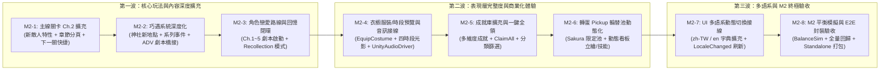

# 20 M2 系統完整（Feature Complete）與內容擴充實作藍圖

> **文件性質**：M2 階段總體架構規劃與分步實作規格書（M2 Feature Complete & Content Expansion Blueprint）
> **建立日期**：2026-11-06
> **前置狀態**：**M0（技術驗證）** 與 **M1（垂直切片，`OPT-1` ～ `OPT-8`）** 已 100% 完成並通過雙引擎全量測試與稽核（`.NET 8` 359/359 通過、Unity 6 EditMode 414/414 通過、Windows Standalone 建置通過）。
> **依據文件**：[`design/16_roadmap.md`](16_roadmap.md)、[`design/17_framework_worklist.md`](17_framework_worklist.md)、[`design/19_optimization_and_m1_implementation_plan.md`](19_optimization_and_m1_implementation_plan.md)、[`client/GEMINI_PROTOCOL.md`](../client/GEMINI_PROTOCOL.md)

---

## 1. M1 完工後之系統現況與 M2 核心缺口盤點（Gap Analysis）

在完成 `OPT-1` ～ `OPT-8` 及深度品質稽核後，客戶端 10 大 UGUI 畫面與底層領域架構已完全打通。邁向 [`design/16_roadmap.md`](16_roadmap.md#L25-L33) 所定義之 **M2 系統完整（Feature Complete）** 里程碑，目前尚有以下 **8 項功能與內容深度缺口** 待依序補齊：

| 任務編號 | 模組維度 | 現況與待補齊缺口（附原始碼 / 資料出處） | M2 推進目標 |
| :--- | :--- | :--- | :--- |
| **`M2-1`** | **主線關卡章節擴充與章節分頁 UI** | [`data/master/stages.json`](../data/master/stages.json) 僅有第 1 章 3 關（`st_1_01`～`st_1_03`），[`enemies.json`](../data/master/enemies.json) 僅有 3 種基礎敵人；[`StageSelectView.cs`](../client/Assets/Game/Unity/UI/StageSelectView.cs) 尚未支援多章節（Ch.1 / Ch.2）分頁切換，[`BattlePageView.cs`](../client/Assets/Game/Unity/Battle/BattlePageView.cs) 結算畫面亦缺少「`▶ 下一關`」直接推進按鈕。 | 擴充第 2 章關卡群（`st_2_01`～`st_2_03`）與新特性敵人（飛行、重裝、遠程支援、範圍免疫主堡），在 `StageSelectView` 支援章節切換分頁，並在 `BattlePageView` 勝利結算提供一鍵挑戰下一關。 |
| **`M2-2`** | **巧遇系統深度化與 ADV 劇本橋接** | [`data/master/encounters.json`](../data/master/encounters.json) 僅 2 個地點（`spot_park`、`spot_cafe`）共 4 個事件；[`EncounterView.cs`](../client/Assets/Game/Unity/UI/EncounterView.cs) 僅以簡化彈窗按鈕結算，尚未支援從巧遇事件啟動 [`StoryPlayerView.cs`](../client/Assets/Game/Unity/UI/StoryPlayerView.cs) 播放完整 ADV 巧遇劇本並回傳選項結算。 | 擴充第 3 個地點（如 `spot_shrine` 櫻花神社）與多角色系列事件（Series 1～3），並在 `EncounterView` 支援橋接 `StoryPlayerView` 演出巧遇劇本與選項獎勵結算。 |
| **`M2-3`** | **角色戀愛路線劇本與回憶模式閉環** | [`StoryHubView.cs`](../client/Assets/Game/Unity/UI/StoryHubView.cs#L257-L320) 的「角色好感路線」分頁雖已列出各角色 Ch.1～Ch.5 的解鎖狀態（`[已通關]` / `[可挑戰]` / `[🔒 Lv.X]`），但點擊章節卡片尚未掛載啟動 `StoryPlayerView` 進行「正式章節攻略（寫入存檔）」或「回憶重播模式（Recollection Mode，使用變數副本不污染存檔）」的互動按鈕。 | 建立角色專屬路線劇本（`route_char01_ch1.txt` 等），並在 `StoryHubView` 串接點擊章節卡片進入正式遊玩（通關後呼叫 `CharacterRouteService.CompleteChapter`）或回憶重播（`StoryPlaybackController` 回憶模式）。 |
| **`M2-4`** | **換裝衣櫥服裝穿戴、四時段燈光預覽與實體音訊驅動接線** | [`WardrobeView.cs`](../client/Assets/Game/Unity/UI/WardrobeView.cs) 目前僅提供立繪階段（`S1`～`S3`）與大廳場景切換，尚未渲染 [`costumes.json`](../data/master/costumes.json) 的服裝穿戴清單（`EquipCostume`）與四時段（早/中/夕/夜）燈光預覽；且 [`GameBootstrap.cs`](../client/Assets/Game/Unity/GameBootstrap.cs#L76) 仍使用 `NullAudioDriver` 而未掛載 [`UnityAudioDriver.cs`](../client/Assets/Game/Unity/Audio/UnityAudioDriver.cs)。 | 在 `WardrobeView` 補齊服裝穿戴清單與四時段（`morning`/`noon`/`evening`/`night`）切換；在 `GameBootstrap` 實例化掛載 `UnityAudioDriver`，讓大廳語音與設定音量滑桿在 Standalone 實際發聲。 |
| **`M2-5`** | **成就系統多維度擴充、分類篩選與一鍵全領** | [`data/master/achievements.json`](../data/master/achievements.json) 目前僅 8 筆基礎成就；[`AchievementView.cs`](../client/Assets/Game/Unity/UI/AchievementView.cs) 與 [`AchievementPresenter`](../client/Assets/Game/Core/UI/Presenters.cs#L120-L176) 尚無分類篩選與「`✨ 一鍵全部領取 (Claim All)`」功能。 | 擴充成就庫至涵蓋戰鬥星數、角色養成、位階進階、好感突破、巧遇探索與結局收集等多維度成就，並在 `AchievementPresenter` / `AchievementView` 實作一鍵領取全部可領取成就與總進度統計。 |
| **`M2-6`** | **轉蛋限定 Pickup 輪替池與動態看板情報驅動** | [`data/master/banners.json`](../data/master/banners.json) 僅有常駐池與 UR 池，且 [`GachaView.cs`](../client/Assets/Game/Unity/UI/GachaView.cs) 的中央特選看板說明在非 `banner_ur` 時硬編碼顯示克萊兒（Claire）字樣，無法根據 `BannerDef.Pickup` 動態載入當期 UP 角色（如櫻粉巫女 Sakura 或熾天使 Seraphina）的立繪、名稱與專屬技能。 | 在 `banners.json` 新增限定角色 Pickup 卡池（如 `banner_sakura_up`），並重構 `GachaView` 100% 依據 `BannerDef.Pickup` 與 `CharacterDef` 動態渲染當期特選看板娘立繪、技能情報與保底說明。 |
| **`M2-7`** | **UI 多語系（`zh-TW` / `en`）動態切換全面接線** | [`SettingsModalView.cs`](../client/Assets/Game/Unity/UI/SettingsModalView.cs) 切換語言時雖已觸發 `ILocalizationService.LocaleChanged`，但 `LobbyView`、`StageSelectView`、`GachaView` 等畫面的主導航與標題文字仍為硬編碼中文，未訂閱 `LocaleChanged` 動態刷新。 | 擴充 `data/loc/zh-TW/strings.json` 與 `data/loc/en/strings.json` 的 UI 介面鍵值，在核心 View 訂閱 `LocaleChanged`，實現 `zh-TW` / `en` 即時無縫切換刷新。 |
| **`M2-8`** | **M2 全系統數值模擬（`BalanceSim`）、E2E 回歸與封裝驗收** | 新增關卡、卡池、劇本與成就後，需透過 `tools/BalanceSim` 驗證所有主線關卡之可通關性與波次壓力，並執行 M2 端到端全鏈路整合測試與 Windows Standalone 打包。 | `BalanceSim` 全關卡模擬通過、`ValidateData` / `ValidateStory` / `LocTool` 0 錯誤、`.NET 8` 與 Unity EditMode 全數綠燈，產出 M2 正式版 `GameClient.exe`。 |

---

## 2. M2 演進路線圖（Execution Flowchart）

---

## 3. 分步實作詳細規格（`M2-1` ～ `M2-8` 工單定義）

以下每個任務皆對應獨立工單檔案 `client/tasks/M2-1.md` ～ `client/tasks/M2-8.md`，嚴格限定修改範圍與驗收查核點：

---

### Task `M2-1`：主線關卡第 2 章擴充、章節分頁切換與戰鬥結算「下一關」推進
- **工單檔案**：[`client/tasks/M2-1.md`](../client/tasks/M2-1.md)
- **目標**：擴充主線第 2 章關卡群（`st_2_01`～`st_2_03`）與新敵人種類，讓 `StageSelectPresenter` / `StageSelectView` 支援章節篩選分頁（Chapter 1 / Chapter 2），並在 `BattlePageView` 勝利結算畫面新增「`▶ 下一關 (NEXT STAGE)`」快捷推進按鈕。
- **允許新增或修改的檔案**：
  - 修改 `data/master/enemies.json`（新增飛行敵人、重裝敵人或遠程法師敵人，並同步至 `StreamingAssets`）
  - 修改 `data/master/stages.json`（新增第 2 章關卡 `st_2_01`、`st_2_02`、`st_2_03`，涵蓋飛行敵波次與 `immune_area` 範圍傷害免疫主堡特性，並同步至 `StreamingAssets`）
  - 修改 `client/Assets/Game/Core/UI/Presenters.cs`（`StageSelectPresenter` 新增 `GetChapters()`、`GetStagesByChapter(int chapter)`、`GetNextUnlockedStageId(string currentStageId)`）
  - 修改 `client/Assets/Game/Unity/UI/StageSelectView.cs`（頂部或左側新增章節分頁按鈕 `[第 1 章]` / `[第 2 章]`）
  - 修改 `client/Assets/Game/Unity/Battle/BattlePageView.cs`（勝利結算時若下一關已解鎖，顯示 `NextStageButton` 點擊直接啟動下一關戰鬥）
  - 修改 `client/Assets/Game/Tests/StageSelectTests.cs` 與 `client/Assets/Game/Tests/BattlePageViewTests.cs`
- **驗收查核點（含 G3 陽性對照）**：
  - `M2_1_1`：`ValidateData` 校驗新增敵人與第 2 章關卡 100% 通過；通關 `st_1_03` 後自動解鎖 `st_2_01`。
  - `M2_1_2`：`StageSelectPresenter.GetStagesByChapter(2)` 正確回傳第 2 章關卡，且 `StageSelectView` 切換章節分頁時正確刷新關卡列表。
  - `M2_1_3`：在 `BattlePageView` 贏得 `st_1_01` 後，結算畫面 `NextStageButton` 為可點擊狀態，點擊後自動啟動 `st_1_02` 戰鬥（陽性對照：戰敗時 `NextStageButton` 隱藏或不可點擊）。

---

### Task `M2-2`：巧遇系統深度化——新地點、多角色系列事件（Series 1～3）與 ADV 劇本橋接
- **工單檔案**：[`client/tasks/M2-2.md`](../client/tasks/M2-2.md)
- **目標**：擴充巧遇探索地點（新增 `spot_shrine` 櫻花神社，通關 `st_1_03` 解鎖）與多角色系列巧遇事件，並讓 `EncounterView` 支援橋接 `StoryPlayerView` 播放巧遇劇本或完成多階段系列推進。
- **允許新增或修改的檔案**：
  - 修改 `data/master/encounters.json`（新增 `spot_shrine` 及 Sakura / Elysia / Luna 系列巧遇事件，並同步至 `StreamingAssets`）
  - 新增 `data/story/encounter_cafe.txt`、`data/story/encounter_shrine.txt`（同步至 `StreamingAssets/Story/`）
  - 修改 `client/Assets/Game/Core/UI/Presenters.cs`（`EncounterPresenter` 擴充系列進度查詢與劇本 ID 映射）
  - 修改 `client/Assets/Game/Unity/UI/EncounterView.cs`（新增「`📖 進入劇情演出`」或自動橋接 `StoryPlayerView` 播放對應巧遇劇本，並在劇本結束後完成 `ResolveEncounter` 結算）
  - 修改 `client/Assets/Game/Tests/EncounterAchievementSettingsViewTests.cs`
- **驗收查核點（含 G3 陽性對照）**：
  - `M2_2_1`：`ValidateData` 與 `ValidateStory` 100% 通過；通關 `st_1_03` 後 `spot_shrine` 自動解鎖。
  - `M2_2_2`：同一角色的 Series 1 事件完成前，Series 2 事件不會被抽中；完成 Series 1 後可推進至 Series 2（陽性對照）。
  - `M2_2_3`：從 `EncounterView` 啟動巧遇劇本演出並完成選項後，正確發放好感度獎勵並清除 `Pending` 狀態。

---

### Task `M2-3`：角色好感路線劇本（Ch.1～Ch.5）與 `StoryHubView` 路線攻略 / 回憶重播閉環
- **工單檔案**：[`client/tasks/M2-3.md`](../client/tasks/M2-3.md)
- **目標**：為核心角色建立專屬好感路線劇本，並在 `StoryHubView` 的「角色戀愛路線」分頁串接點擊章節按鈕：對 `[可挑戰]` 章節啟動正式劇本並在播畢後呼叫 `CharacterRouteService.CompleteChapter` 推進路線；對 `[已通關]` 章節啟動 `StoryPlaybackController` 回憶重播模式（Recollection Mode，使用變數副本不影響正式存檔）。
- **允許新增或修改的檔案**：
  - 新增 `data/story/route_char01_ch1.txt`、`data/story/route_char18_ch1.txt`（同步至 `StreamingAssets/Story/`）
  - 修改 `client/Assets/Game/Unity/UI/StoryHubView.cs`（為角色路線章節卡片掛載點擊事件，支援啟動 `StoryPlayerView` 正式攻略與回憶重播）
  - 修改 `client/Assets/Game/Unity/UI/StoryPlayerView.cs`（支援傳入 `isRecollection` 旗標與播畢回呼 `Action onCompleted`）
  - 修改 `client/Assets/Game/Tests/StoryPlayerViewTests.cs`
- **驗收查核點（含 G3 陽性對照）**：
  - `M2_3_1`：角色好感達 Lv.1 時，在 `StoryHubView` 點擊 Ch.1 `[可挑戰]` 並播完劇本後，該角色 Ch.1 狀態自動變為 `[已通關]`，且解鎖對應路線 CG 或進度。
  - `M2_3_2`：對 `[已通關]` 章節執行「回憶重播模式」，在劇本中修改變數或選擇不同分支，播畢後玩家的正式 `StoryState` 變數完全不受污染（陽性對照）。
  - `M2_3_3`：好感等級不足（`[🔒 Lv.X]`）的章節點擊時遭到攔截，不會啟動播放器。

---

### Task `M2-4`：換裝衣櫥服裝穿戴、四時段光線預覽與 `UnityAudioDriver` 實體音訊接線
- **工單檔案**：[`client/tasks/M2-4.md`](../client/tasks/M2-4.md)
- **目標**：在 `WardrobeView` 補齊服裝清單穿戴按鈕（呼叫 `WardrobePresenter.EquipCostume`）與大廳四時段（早 `morning` / 中 `noon` / 夕 `evening` / 夜 `night`）燈光預覽及切換；並在 `GameBootstrap` 正式掛載 `UnityAudioDriver` 取代 `NullAudioDriver`，讓 BGM/SE/Voice 與 `SettingsModalView` 音量滑桿完整連動。
- **允許新增或修改的檔案**：
  - 修改 `client/Assets/Game/Core/UI/Presenters.cs`（`WardrobePresenter` 擴充 `GetUnlockedCostumes(string charId)` 與時段設定支援）
  - 修改 `client/Assets/Game/Unity/UI/WardrobeView.cs`（新增服裝穿戴按鈕列與四時段 `[🌅 早晨] [☀️ 正午] [🌇 夕暮] [🌙 夜晚]` 切換按鈕）
  - 修改 `client/Assets/Game/Unity/UI/LobbyView.cs`（讀取設定之時段並套用 `SetBackground` 四時段燈光色調）
  - 修改 `client/Assets/Game/Unity/GameBootstrap.cs`（建立 `UnityAudioDriver` 掛載於 `GameApp` 並傳入 `AudioService`）
  - 修改 `client/Assets/Game/Tests/CharacterAndWardrobeViewTests.cs`
- **驗收查核點（含 G3 陽性對照）**：
  - `M2_4_1`：在 `WardrobeView` 點擊已解鎖服裝可成功穿戴並更新 `Player.Characters[charId].EquippedCostume`；嘗試穿戴未解鎖服裝時回傳 `costume_locked`（陽性對照）。
  - `M2_4_2`：在 `WardrobeView` 切換時段為 `night` 並返回 `LobbyView`，大廳背景燈光色調立即切換為夜間冷藍色調（`#C8D0FF`）。
  - `M2_4_3`：`GameBootstrap.Boot()` 後 `GameServices.Audio` 綁定真實 `UnityAudioDriver`，調整 `SettingsModalView` 音量滑桿即時同步更新 `AudioSource.volume`。

---

### Task `M2-5`：成就系統多維度擴充、分類篩選與「一鍵全部領取（Claim All）」
- **工單檔案**：[`client/tasks/M2-5.md`](../client/tasks/M2-5.md)
- **目標**：擴充 `data/master/achievements.json` 涵蓋戰鬥、養成、進階、巧遇、劇情等多維度成就，並在 `AchievementPresenter` 與 `AchievementView` 實作分類標籤篩選及「`✨ 一鍵全部領取 (Claim All)`」按鈕。
- **允許新增或修改的檔案**：
  - 修改 `data/master/achievements.json`（擴充成就定義並同步至 `StreamingAssets`）
  - 修改 `client/Assets/Game/Core/UI/Presenters.cs`（`AchievementPresenter` 新增 `ClaimAll()` 批次領取所有可領取成就並回傳領取總數與獲得寶石總額）
  - 修改 `client/Assets/Game/Unity/UI/AchievementView.cs`（頂部新增 `ClaimAllButton` 與完成度統計顯示）
  - 修改 `client/Assets/Game/Tests/EncounterAchievementSettingsViewTests.cs`
- **驗收查核點（含 G3 陽性對照）**：
  - `M2_5_1`：當有多個成就同時處於「已達成未領取」狀態時，呼叫 `AchievementPresenter.ClaimAll()` 或點擊 `ClaimAllButton` 可一次領取全部獎勵，寶石總額精確累加，且大廳 `RedDotBadge` 立即熄滅。
  - `M2_5_2`：當沒有任何可領取成就時，呼叫 `ClaimAll()` 回傳領取數 `0` 且寶石不變（陽性對照）。

---

### Task `M2-6`：轉蛋限定 Pickup 輪替卡池擴充與 `GachaView` 動態看板驅動
- **工單檔案**：[`client/tasks/M2-6.md`](../client/tasks/M2-6.md)
- **目標**：在 `data/master/banners.json` 新增限定角色特選卡池（如 `banner_sakura_up` 櫻粉巫女特選池、`banner_seraphina_up` 熾天使特選池），並重構 `GachaView` 的特選看板舞台，使其 100% 動態讀取 `BannerDef.Pickup` 第一位主打角色的立繪、稀有度、全名與專屬技能說明，消除硬編碼 Claire 文字。
- **允許新增或修改的檔案**：
  - 修改 `data/master/banners.json`（新增 `banner_sakura_up` 等限定 Pickup 卡池，並同步至 `StreamingAssets`）
  - 修改 `client/Assets/Game/Core/UI/Presenters.cs`（`GachaPresenter` 新增 `GetFeaturedCharacterInfo(string bannerId)` 查詢當期主打角色 `CharacterDef`）
  - 修改 `client/Assets/Game/Unity/UI/GachaView.cs`（切換卡池時動態載入主打角色立繪、名稱與 `Battle.Skill` 說明）
  - 修改 `client/Assets/Game/Tests/GachaPresenterTests.cs` 與 `client/Assets/Game/Tests/GachaViewTests.cs`
- **驗收查核點（含 G3 陽性對照）**：
  - `M2_6_1`：`ValidateData` 對新增卡池之機率總和與稀有度池校驗 100% 通過。
  - `M2_6_2`：在 `GachaView` 切換至 `banner_sakura_up` 時，中央特選看板自動切換為櫻（`char18_sakura_miko`）的立繪、名稱與技能【紅蓮神樂】，不再顯示克萊兒（陽性對照）。

---

### Task `M2-7`：UI 多語系鍵值（`zh-TW` / `en`）擴充與動態語言切換刷新
- **工單檔案**：[`client/tasks/M2-7.md`](../client/tasks/M2-7.md)
- **目標**：擴充 `data/loc/zh-TW/strings.json` 與 `data/loc/en/strings.json` 的 UI 介面鍵值（大廳導航、出擊、設定、成就、選關標題等），並在 `LobbyView`、`SettingsModalView`、`StageSelectView` 等核心畫面訂閱 `GameServices.Localization.LocaleChanged`，實現切換語言時 UI 文字即時刷新為繁體中文或英文。
- **允許新增或修改的檔案**：
  - 修改 `data/loc/zh-TW/strings.json` 與 `data/loc/en/strings.json`（並透過 `MasterDataSync` 同步至 `StreamingAssets/Loc/`）
  - 修改 `client/Assets/Game/Unity/Editor/MasterDataSync.cs`（新增同步 `data/loc/` 至 `Assets/StreamingAssets/Loc/`）
  - 修改 `client/Assets/Game/Unity/UI/LobbyView.cs`、`client/Assets/Game/Unity/UI/SettingsModalView.cs`、`client/Assets/Game/Unity/UI/StageSelectView.cs`
  - 修改 `client/Assets/Game/Tests/LobbyViewTests.cs` 與 `client/Assets/Game/Tests/EncounterAchievementSettingsViewTests.cs`
- **驗收查核點（含 G3 陽性對照）**：
  - `M2_7_1`：執行 `tools/LocTool` 檢查 `zh-TW` 與 `en` 鍵值 100% 對齊無缺漏。
  - `M2_7_2`：在 `SettingsModalView` 將語言由 `zh-TW` 切換為 `en` 後，`LobbyView` 的主導航與出擊按鈕文字即時更新為英文（再切回 `zh-TW` 即時恢復繁體中文）。

---

### Task `M2-8`：M2 全系統平衡模擬（`BalanceSim`）、端到端全鏈路回歸與 Standalone 封裝驗收
- **工單檔案**：[`client/tasks/M2-8.md`](../client/tasks/M2-8.md)
- **目標**：對 M2 擴充後的所有主線關卡執行 `tools/BalanceSim` 戰鬥平衡模擬驗證，擴充 `UnityIntegrationPlayModeTests` 覆蓋 M2 新功能（第 2 章選關推進、巧遇劇本、角色路線與回憶重播、衣櫥穿戴與時段切換、一鍵領取成就、Pickup 輪替池、多語系切換），並重新打包 Windows Standalone 執行檔 `build/Windows/GameClient.exe`。
- **允許新增或修改的檔案**：
  - 修改 `client/Assets/Game/Tests/UnityIntegrationPlayModeTests.cs`
  - 修改 `design/16_roadmap.md`、`design/17_framework_worklist.md`、`client/README.md`、`SESSION.md`
- **驗收查核點（含 G3 陽性對照）**：
  - `M2_8_1`：`tools/ValidateData`、`tools/ValidateStory`、`tools/LocTool`、`tools/BalanceSim` 全數 0 錯誤通過。
  - `M2_8_2`：`.NET 8` CLI 測試與 Unity 6 LTS EditMode 測試 100% 通過，且 M2 端到端整合測試通過 G3 陽性對照。
  - `M2_8_3`：`BuildScript.BuildWindows` 成功產出最新 `build/Windows/GameClient.exe`（Exit Code 0）。
