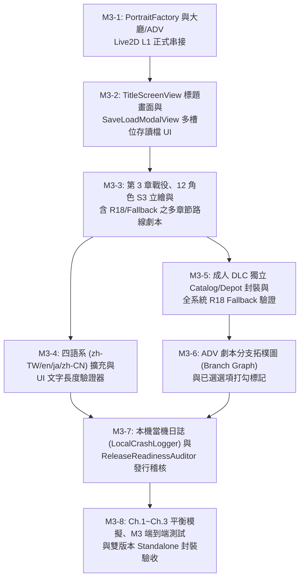

# 21 M3 內容量產、Live2D 畫面實裝、四語系與成人 DLC 管線實作計畫（M3 Implementation Plan）

> **角色定位**：系統架構師（System Architect）
> **建立日期**：2026-11-06
> **前置基礎**：
> - **M0（技術驗證）**、**M1（垂直切片，`OPT-1`～`OPT-8`）**、**M2（系統完整，`M2-1`～`M2-8`）** 與 **`F5`（Live2D Cubism SDK 5-r.6.1 官方模型整合與效能基準）** 均已 100% 完成並通過雙端全量測試（`.NET 8` 361/361、Unity 6 LTS EditMode 429/429）。
> - 本文件依據 [`design/16_roadmap.md`](16_roadmap.md) M3 / M4、[`design/09_live2d.md`](09_live2d.md)、[`design/12_localization.md`](12_localization.md)、[`design/14_ui_screens.md`](14_ui_screens.md) 與 [`design/15_asset_pipeline_contract.md`](15_asset_pipeline_contract.md)，規劃下一階段 **M3 內容量產、Live2D 畫面實裝與四語系/DLC 封裝（`M3-1` ～ `M3-8`）** 的分步實作藍圖。

---

## 1. 現況盤點與 M3 核心目標差距分析

| 領域維度 | 目前已完成狀態（M0 + M1 + M2 + F5） | M3 / M4 目標狀態（[`design/16_roadmap.md`](16_roadmap.md)） | 對應工單 |
| :--- | :--- | :--- | :---: |
| **Live2D 畫面實裝** | 已匯入 `CubismSdkForUnity-5-r.6.1` 並完成 `Live2DPortraitView` 與 `F5` 基準測試，但 `LobbyView` / `StoryPlayerView` 尚未透過 `PortraitFactory` 動態掛載 Live2D L1 模型 | 實作 `PortraitFactory`：當 `UseLive2d == true` 且模型存在時於大廳與 ADV 啟用 `Live2DPortraitView`（支援視線跟隨、部位點擊、打字/語音口型同步），關閉或無模型時無縫退回靜態立繪 | **M3-1** |
| **標題畫面與多槽位存讀檔 UI** | 啟動直接進入 `LobbyView`；`StoryPlayerView` 僅有單一槽位快捷存讀檔按鈕 | 補齊 [`design/14_ui_screens.md`](14_ui_screens.md) §1 定義之 `TitleScreenView`（開始/繼續/設定/結束 + 首次啟動年齡確認閘門）與視覺化多槽位 `SaveLoadModalView`（`slot_001`～`slot_006`、`quick`、`auto`） | **M3-2** |
| **戰役、角色與 R18/G 路線量產** | 第 1～2 章共 6 關、9 位角色、2 條 Ch.1 路線劇本 | 擴充主線第 3 章（`st_3_01`～`st_3_03`）、擴充第一梯隊角色至 12 位（含 S3 立繪階段），並建立含 `rating:R18` 與 `fallback:` 節點之多章節路線劇本（Ch.1～Ch.3） | **M3-3** |
| **四語系在地化與文字長度檢查** | 支援 `zh-TW` 與 `en`（各 60 條鍵值） | 新增日文（`ja`）與簡體中文（`zh-CN`）構成四大首發語言；在 `LocalizationValidator` 與 `LocalizationTool` 實作 **UI 文字最大長度檢查** 與富文字標籤檢查；設定頁支援四語系切換 | **M3-4** |
| **成人 DLC 獨立打包與 Fallback** | `AddressablesCatalogAuditor` 已支援本體 R18 攔截，尚無自動化雙包建置與 DLC 熱切換全鏈路驗證 | 在 `BuildScript` 實作本體與成人 DLC 獨立目錄封裝，並對所有 R18 劇本節點、CG 圖鑑、立繪與成就進行 `G` / `R18` 雙政策 Fallback 全面驗證 | **M3-5** |
| **ADV 分支拓樸圖與已選選項標記** | `StoryHubView` 支援主線、路線、圖鑑、結局列表，尚未提供分支圖與已選選項打勾 | 在 `StoryPlayerView` 對已選過的選項顯示 `✓` 標記；在 `StoryHubView` / `StoryPlayerView` 新增視覺化「劇情分支拓樸圖（Branch Flowchart）」，標示已探索與未探索路徑 | **M3-6** |
| **本機當機日誌與發行就緒稽核** | 存檔具原子寫入與 SHA-256 保護，尚缺本機結構化 Crash Logger 與發行前綜合檢查器 | 實作純本機 `LocalCrashLogger`（只存本機 `persistentDataPath/logs/`，零外部連線）與 `ReleaseReadinessAuditor`（一鍵檢查 manifest、四語系、R18 隔離与效能） | **M3-7** |
| **M3 全矩陣模擬與端到端封裝** | M1 與 M2 端到端測試通過 | 執行 Ch.1～Ch.3 `BalanceSim` 全矩陣模擬、擴充 `UnityIntegrationPlayModeTests` 驗證 M3 完整玩家旅程，並重新產出 `GameClient.exe` | **M3-8** |

---

## 2. 任務架構與相依性拓樸圖

---

## 3. 分步工單規格（`M3-1` ～ `M3-8`）

| 工單檔案 | 主題 | 關鍵查核點（含 G3 陽性對照） |
| :--- | :--- | :--- |
| [`client/tasks/M3-1.md`](../client/tasks/M3-1.md) | `PortraitFactory` 與 `LobbyView` / `StoryPlayerView` Live2D L1 正式串接 | `UseLive2d=true` 且有模型時回傳 `Live2DPortraitView`；`UseLive2d=false` 時強制退回靜態立繪（陽性對照）；ADV 台詞推進與 `<<expr>>` 同步驅動 Live2D 表情與口型 |
| [`client/tasks/M3-2.md`](../client/tasks/M3-2.md) | `TitleScreenView` 標題畫面與 `SaveLoadModalView` 多槽位存讀檔介面 | 標題畫面支援「開始新遊戲 / 繼續遊戲 / 存讀檔 / 設定」；多槽位存讀檔支援 `slot_001`～`slot_006` 寫入與讀取還原（陽性對照：讀取空槽位回報 `slot_not_found`） |
| [`client/tasks/M3-3.md`](../client/tasks/M3-3.md) | 第 3 章戰役（`st_3_01`～`st_3_03`）、12 角色與 Ch.1～Ch.3 R18/Fallback 路線劇本 | `ValidateData` 與 `ValidateStory` 100% 通過；`G` 政策下遊玩 Ch.3 自動跳轉 `fallback` 節點，`R18` 政策下進入成人節點（陽性對照） |
| [`client/tasks/M3-4.md`](../client/tasks/M3-4.md) | 四語系（`zh-TW` / `en` / `ja` / `zh-CN`）全面擴充與 UI 文字超長驗證器 | 四語系鍵值 100% 對齊；`LocalizationValidator.ValidateMaxLength` 精確攔截超長字串（陽性對照）；`SettingsModalView` 支援切換 `ja` 與 `zh-CN` |
| [`client/tasks/M3-5.md`](../client/tasks/M3-5.md) | 成人 DLC 獨立打包管線與全系統 R18 Fallback 安全審計 | 本體 Catalog 含 R18 資產時立即攔截失敗（陽性對照）；DLC 資產獨立輸出至 `DLC_Adult`；未安裝 DLC 時即使 `RatingOptIn=R18` 仍強制維持 `G` |
| [`client/tasks/M3-6.md`](../client/tasks/M3-6.md) | ADV 劇本分支拓樸圖（`StoryBranchGraphBuilder`）與已選選項打勾標記（`✓`） | 自動解析 `StoryScript` 節點與分支邊；已走過的選項與節點標記為已探索（`✓`），未走過的分支顯示為未探索（陽性對照） |
| [`client/tasks/M3-7.md`](../client/tasks/M3-7.md) | 本機結構化當機日誌（`LocalCrashLogger`）與 `ReleaseReadinessAuditor` | 當機日誌只寫入本機 `logs/` 且保留最近 N 份輪替；`ReleaseReadinessAuditor` 在發現 `placeholder` 資產或缺失翻譯時阻擋發行（陽性對照） |
| [`client/tasks/M3-8.md`](../client/tasks/M3-8.md) | M3 全系統平衡模擬、端到端全鏈路回歸與 Standalone 封裝驗收 | 四大 CLI 工具 100% 通過；`.NET 8` 與 Unity EditMode 全數綠燈（含 G3 陽性對照）；`GameClient.exe` 建置 Exit Code 0 |
